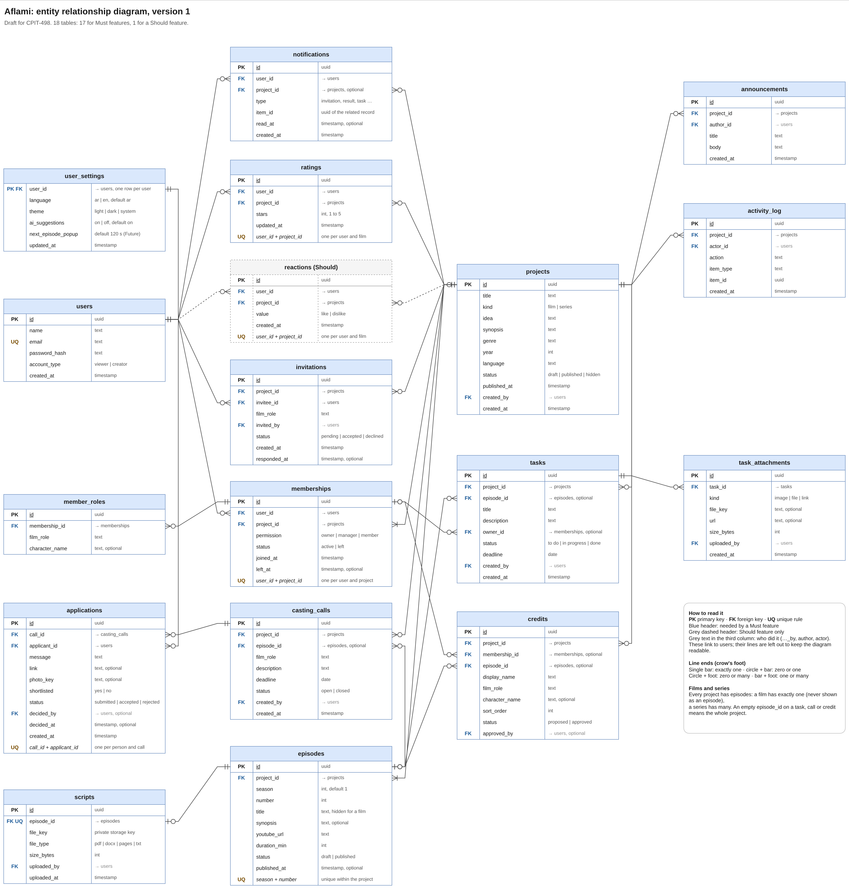

# Aflami Software Design Document

## Document control

This document shows how Aflami version 1 will be built. The [Aflami Software Requirements Specification](../requirements/Aflami_SRS.md) says what it must do, including the use case diagram; this document holds every other diagram the supervisor asked for.

| Field | Value |
| --- | --- |
| Course | CPIT-498 (design), built in CPIT-499 |
| Authors | Anas Aazib, Abdullah Al-Jadani |
| Supervisor | Prof. Adeeb Rida Noor |
| Version | 0.1, template |

**Rules for every diagram:**

- Draw it in one tool (draw.io or PlantUML), keep its source in `design/diagrams/`, export the image to `design/exports/`, and place the image in its section here.
- Under each diagram, list the requirement IDs it covers (FR-…, NFR-…).
- Use the same names as the SRS: table names, state names and role names (Owner, Manager, Member, Applicant, Viewer).
- The content in each section below is *starter* material from the design so far; replace each *Guidance* line with the diagram and delete it before you submit.

## 1 Architecture: components and deployment

Aflami is one web app and one back end with a module per feature, over one PostgreSQL database; the film video stays on YouTube.

| Component | Technology | Responsibility | Talks to |
| --- | --- | --- | --- |
| Web app | Next.js, React, TypeScript | Arabic screens, forms, the public film page | Back-end API |
| Back-end API | NestJS | Modules: Accounts and roles, Projects and scripts, Casting and team, Approvals, Tasks, Film page and credits. A permission guard runs on every request | Database |
| Database | PostgreSQL | The tables in section 2 | Back-end API only |
| Video | YouTube embedded player | Plays the film on the film page | Viewer's browser |
| Build and deploy | GitHub Actions, Vercel | Runs the tests on every pull request, then deploys | Repository |

*Guidance: draw two diagrams. (1) A UML component diagram of the six modules and what each one calls, so the module links are visible. (2) A deployment diagram with these nodes: the user's browser, Vercel, the database host, YouTube and GitHub.*

*Open decision for the hosting plan (week 13): where PostgreSQL is hosted, and its free-tier limits.*

Covers: FR-ACC-02, NFR-MNT-01, NFR-PRT-01.

## 2 Data model (ERD)
 
Seventeen tables hold version 1: sixteen are needed by Must features, and one (reactions) only by a Should feature. The key idea is one chain: an accepted application creates a membership, the membership owns tasks, and it becomes a credit.
 

 
Source: `design/diagrams/Aflami_ERD.drawio`.
 
| Table | Holds | Links to | Rules |
| --- | --- | --- | --- |
| users | One account: name, email, password hash, account type (viewer or creator) | — | Email is unique |
| user_settings | One user's settings: language, theme, AI suggestions on or off, when the "next episode" pop-up appears | users | Exactly one row per user, created with default values at sign-up. Visitors without an account keep their language and theme in a browser cookie |
| projects | One film: title, idea, synopsis, film details, YouTube link, status (draft, published or hidden) | users (creator) | Only the owner publishes or hides it |
| scripts | The project's script file and its type (PDF, DOCX, Pages or TXT) | projects | At most one per project: a new upload replaces the old file; only members can open it |
| memberships | A person's place in a project: permission (owner, manager or member) and status (active or left) | users, projects | One per user and project; one owner per project, many managers allowed; never deleted |
| member_roles | The film roles a member holds, with the character name for actors | memberships | A member can hold many film roles |
| invitations | An invitation to a registered user, with the film role offered | projects, users | Sent by the owner or a manager; accepting creates a membership |
| casting_calls | A public call for one film role, with a deadline | projects | Status open or closed; closing stops new applications only |
| applications | One person's application: message, optional link and photo, shortlisted flag | casting_calls, users | One per person and call; waiting applications stay when the call closes |
| tasks | A piece of work: owner, status, deadline | projects, memberships | Owner becomes empty when that member leaves |
| task_attachments | Images, files or links on a task | tasks | Size limit per file |
| credits | One line of the film's credits | projects, memberships | Proposed from the team, then approved; membership is empty for people outside Aflami |
| ratings | A creator's star rating of a film, 1 to 5 | users, projects | One per user and film; the film's own team cannot rate it |
| reactions (Should) | A like or dislike | users, projects | One per user and film; needs an account |
| notifications | A message to one user inside Aflami | users, projects | Read or unread |
| announcements | A message from the owner to the whole team | projects, users (author) | — |
| activity_log | Who did what and when in a project | projects, users (actor) | Written by the system, never edited |
 
*Fields ending in `_by`, and `author_id` and `actor_id`, record who did something. They link to users; the diagram leaves out their lines to stay readable.*
 
*Decided in weeks 11 and 12: invitations stay in version 1; the second permission level is called Manager; only the newest script is kept; an application is a message plus an optional link; closing a call leaves waiting applications as they are; shortlisting is a yes/no flag, not a separate status.*
 
Covers: SRS 3.5, FR-ACC-03, FR-PRJ-02, FR-CST-02, FR-TEAM-01, FR-TEAM-02, FR-FILM-01.

## 3 Class diagram

The class diagram shows the ten entities from section 2, their enums, and the services whose methods appear in the sequence diagrams.

| Class | Kind | Key operations (starter) |
| --- | --- | --- |
| PermissionGuard | Service | canAct(user, project, action) |
| ProjectService | Service | create(owner, data), setManager(project, membership, actor), publish(project, actor) |
| ScriptService | Service | upload(project, pdf, actor): replaces the previous version |
| ApplicationService | Service | submit(call, applicant), accept(application, actor), reject(application, actor) |
| InvitationService | Service | invite(project, invitee, filmRole, actor), accept(invitation), decline(invitation) |
| MembershipService | Service | createFromApplication(application), createFromInvitation(invitation), addFilmRole(membership, role), leave(membership) |
| TaskService | Service | create(project, task, actor), assign(task, membership), updateStatus(task, status, actor) |
| CreditService | Service | proposeFromTeam(project), approve(credit, actor) |
| User, Project, Script, Membership, MemberRole, Invitation, CastingCall, Application, Task, Credit | Entities | The fields in section 2 |
| Permission, MembershipStatus, InvitationStatus, ApplicationStatus, TaskStatus, CreditStatus, FilmRole | Enums | The values in section 2 |

*Guidance: show associations with multiplicities that match the ERD, and every operation that a sequence diagram in section 6 calls.*

Covers: FR-ACC-02, FR-CST-02, FR-TSK-01, FR-FILM-01.

## 4 Main workflow (activity diagram)

The activity diagram follows one film from the new project to the published page, with a swimlane for each actor: Owner or Manager, Applicant, Member, System, Viewer.

1. Owner creates the project and adds the script.
2. Owner or Manager publishes casting calls, and may invite known people.
3. Applicant applies.
4. **Decision:** Owner or Manager accepts or rejects. Accepted: the system creates the membership. Rejected: the applicant sees the result.
5. **Loop** back to step 2 until the team is complete.
6. Owner or Manager creates tasks and assigns an owner to each.
7. Members update their tasks. **Loop** until the work is done.
8. Owner adds the YouTube link.
9. System proposes the credits from the team's film roles.
10. Owner or Manager edits and approves the credits.
11. Owner publishes the film page; viewers can watch it.

*Guidance: draw steps 4, 5 and 7 as a decision and two loops, and steps 2 and 6 as work that can run at the same time.*

Covers: FR-PRJ-01, FR-CST-01, FR-CST-02, FR-TSK-01, FR-FILM-01, FR-FILM-02.

## 5 Record states (state diagrams)

Draw one state machine diagram per record; the supervisor asked for these at minimum: application, task and credit. Each transition says what triggers it and who may trigger it.

| Record | From | Event (who) | To | Effect |
| --- | --- | --- | --- | --- |
| Application | Submitted | Accept (Owner, Manager) | Accepted | Creates the membership, or adds the film role if already a member |
| Application | Submitted | Reject (Owner, Manager) | Rejected | Applicant sees the result |
| Task | To do | Start (task owner) | In progress | — |
| Task | In progress | Finish (task owner) | Done | — |
| Credit | Proposed | Approve (Owner, Manager) | Approved | Records who approved |
| Membership | Active | Leave (member, or Owner) | Left | Their open tasks lose their owner; their credits are flagged for review |
| Invitation | Pending | Accept or decline (invitee) | Accepted or Declined | Accept creates the membership |
| Project | Draft | Publish (Owner) | Published | Needs a YouTube link and approved credits |

*Note: the first presentation showed Published as a credit state. In this design, publishing belongs to the project, so slide 11 changes in week 14.*

*Open decisions: what happens to Submitted applications when a call closes? Can a Done task be reopened, and by whom?*

Covers: FR-CST-02, FR-TSK-01, FR-FILM-01, FR-FILM-02.

## 6 Key scenarios (sequence diagrams)

Four scenarios only, as the supervisor asked: the three flows that make Aflami different, plus the permission check that guards them all.

### SD-1 Accept an applicant (Abdullah)

Participants: Owner, Web app, ApplicationService, PermissionGuard, MembershipService, Database.

1. Owner chooses Accept on an application.
2. PermissionGuard checks that the Owner may decide in this project.
3. ApplicationService marks it Accepted and records who decided and when.
4. MembershipService creates the membership, or adds the film role if the applicant is already a member.
5. Web app shows the new member in the team.

Covers: FR-CST-02, FR-TEAM-01, FR-ACC-02.

### SD-2 Assign a task and update it (Abdullah)

Participants: Manager, Member, Web app, TaskService, PermissionGuard, Database.

1. Manager creates a task and assigns it to a member.
2. PermissionGuard checks the Manager's rights; TaskService saves the task as To do.
3. Member moves the task to In progress, then Done.
4. PermissionGuard checks that this member owns the task before each change.

Covers: FR-TSK-01, FR-ACC-02.

### SD-3 Approve the credits and publish the film page (Abdullah)

Participants: Owner, Web app, CreditService, ProjectService, Database, Viewer, YouTube.

1. CreditService proposes the credits from the team's film roles.
2. Owner edits and approves them.
3. ProjectService checks for a YouTube link and approved credits, then publishes.
4. A Viewer opens the page; the browser loads the video from YouTube.

Covers: FR-FILM-01, FR-FILM-02.

### SD-4 Permission check on any request (Anas)

Participants: User, Web app, API module, PermissionGuard, Database.

1. The user sends a request about a project.
2. PermissionGuard reads the user's membership in that project.
3. No active membership, or a permission too low: the request is refused and nothing changes.
4. Otherwise the module handles the request.

Covers: FR-ACC-02, NFR-PRV-01.

*Guidance: use the class and method names from section 3, and show the refusal path in each diagram as an alternative fragment.*

## 7 Diagram checklist and consistency checks

Seven diagram types make the full set the supervisor asked for; tick each when its image and its "Covers" line are in place.

- [ ] Use case diagram, in the SRS section 3.2 (Anas, week 12)
- [ ] ERD, section 2 (Anas, week 12)
- [ ] Component and deployment diagrams, section 1 (Anas, week 13)
- [ ] Class diagram, section 3 (Anas, week 13)
- [ ] Activity diagram, section 4 (Abdullah, week 13)
- [ ] State diagrams for application, task and credit, section 5 (Abdullah, week 13)
- [ ] Sequence diagrams SD-1 to SD-3 (Abdullah) and SD-4 (Anas), section 6 (week 13)

**Before sending to the supervisor, check that the diagrams agree:**

- Every actor in the use case diagram is a role in section 1.5 of the SRS.
- Every class in a sequence diagram, and every method it calls, is in the class diagram.
- Every state in a state diagram is a value of a status field in the ERD.
- Every step of the activity diagram matches a use case.
- Every diagram's "Covers" IDs appear in the SRS traceability matrix (SRS 5.2).
