# Aflami Software Design Document
 
## Document control
 
This document shows how Aflami version 1 will be built. The [Aflami Software Requirements Specification](../requirements/Aflami_SRS.md) says what it must do, including the use case diagram; this document holds every other diagram the supervisor asked for.
 
| Field | Value |
| --- | --- |
| Course | CPIT-498 (design), built in CPIT-499 |
| Authors | Anas Azib, Abdullah Al-Jadani |
| Supervisor | Prof. Adeeb Rida Noor |
| Version | 0.9, for the supervisor's review (week 13) |
 
**How the diagrams are kept:**
 
- Every diagram is drawn in draw.io. Its source is in `design/diagrams/`, its image is in `design/exports/`, and the image sits in its section here.
- Each section ends with the requirement IDs its diagrams cover (Covers: FR-…, NFR-…).
- The names match the SRS: table names, state names and role names (Owner, Manager, Member, Applicant, Viewer).
- Section 8 lists the first drafts of the screen designs, kept in `design/wireframes/`.

**Design decisions.** Sections 1, 2 and 3 end with the decisions behind their design, numbered DD-01 to DD-24. Each gives why we chose it, what we did not choose, and the cost we accept, so a reviewer can check the reasoning and the slides can refer to a decision by its number.

## 1 Architecture: components and deployment

Aflami is one web app and one back end, over one PostgreSQL database on Supabase, which also stores the files; the film video stays on YouTube. The back end has five feature modules and one Shared module, and no two modules call each other.

| Component | Technology | Responsibility | Talks to |
| --- | --- | --- | --- |
| Web app | Next.js, React, TypeScript | Arabic and English screens, forms, the public film page | Back-end API, file storage (signed links), YouTube player |
| Back-end API | NestJS, deployed as one Vercel Function | Five feature modules: Accounts, Projects, Casting and team, Tasks, Film page. A Shared module holds PermissionGuard, NotificationService, FileService, ActivityLogService and the daily cleanup; the permission guard runs on every request | Database, file storage |
| Database | PostgreSQL on Supabase (free plan) | The tables in section 2, reached through Supabase's connection pooler in transaction mode (port 6543) | Back-end API, the daily export |
| File storage | Supabase Storage, private buckets | Scripts, task attachments and photos. The browser uploads straight to storage with a signed link; private files open through links that expire | Browser, back-end API |
| Video | YouTube embedded player | Plays the film on the film page | Viewer's browser |
| Build and deploy | GitHub Actions, Vercel | GitHub Actions runs the tests on every pull request; Vercel deploys every push to main | Repository |
| Scheduled jobs | GitHub Actions | Once a day: exports the database, encrypts the export and pushes it to a private repository (`aflami-backups`) that keeps the last 30 days; then calls the API's cleanup route for the rules of SRS 3.5. Running them also keeps the free Supabase project active | Database, back-end API, `aflami-backups` |
| AI drafts (Should) | Background job (Vercel Workflows) calling an external AI model from the server | Reads an episode's script and saves drafts for a person to approve; the page shows progress, and the user can leave and come back | Back-end API, AI model |

### 1.1 Component diagram

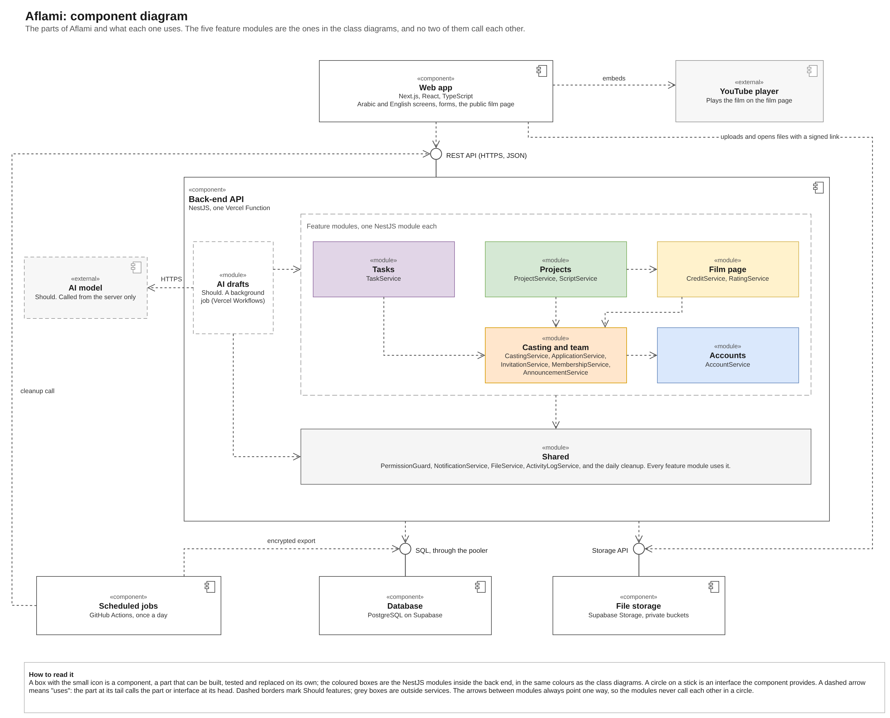

Source: `design/diagrams/Aflami_Component_Diagram.drawio`.

The modules are the ones in the class diagrams (section 3), and every dependency between them points one way:

| Module | Uses | Why |
| --- | --- | --- |
| Projects | Casting and team | Creating a project makes the creator its owner, which is a membership |
| Projects | Film page | Publishing checks that the credits are approved (`ProjectService.missingForPublish`) |
| Casting and team | Accounts | An invitation finds the person's account by email |
| Tasks | Casting and team | A task's owner is a membership |
| Film page | Casting and team | Credits are proposed from the members' film roles, and the team cannot rate its own film |
| Every feature module | Shared | The permission check, notifications, files and the activity log |
| AI drafts (Should) | Feature modules, Shared | An approved draft is saved through the module's own service, so the same permission checks apply; every suggestion and its outcome goes to the activity log |

### 1.2 Deployment diagram

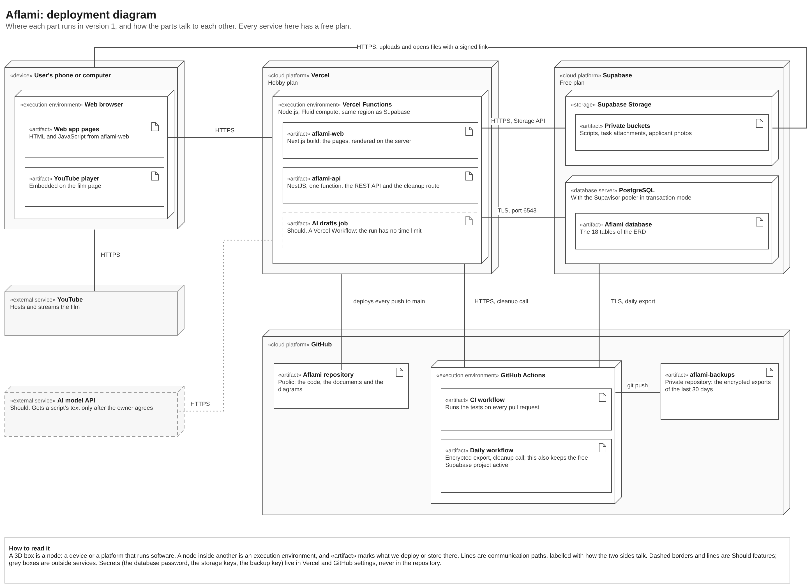

Source: `design/diagrams/Aflami_Deployment_Diagram.drawio`.

- One repository, two Vercel projects: `aflami-web` (Next.js) and `aflami-api` (NestJS, which Vercel runs as one function).
- Both Vercel projects run in the same region as the Supabase project, so each database query stays inside one region.
- Files go straight between the browser and Supabase Storage through signed links that the API hands out after its checks (DD-07).
- The daily export is encrypted with a key kept in GitHub's secret settings and pushed to the private `aflami-backups` repository (DD-08). It is never committed to the public repository or saved as a GitHub Actions artifact.
- Database passwords, storage keys and the backup key live only in Vercel and GitHub settings (NFR-SEC-07).
- What could go wrong with this setup, and how we handle it, is in [Aflami hosting plan and risks](../proposal/Aflami_Hosting_and_Risks.md).

### 1.3 Design decisions

**DD-01 One back end split into modules, not separate services.**

- *Why:* two students build Aflami in one semester (CPIT-499). One code base, one deployment and one database keep that realistic. The modules keep each feature's code apart, follow who owns which requirements (FR-ACC and FR-PRJ: Anas; FR-CST, FR-TEAM, FR-TSK and FR-FILM: Abdullah), and can be tested one at a time.
- *Not chosen:* a separate service for each feature (microservices), which adds network calls, several deployments and data split across databases, with no gain at this size. Next.js alone, with its own API routes, would also work, but NestJS gives one guard that runs before every request (DD-03) and a module system that keeps the boundaries visible.
- *Cost we accept:* two Vercel projects (the web app and the API) instead of one, and the first request after a quiet period waits while the API function starts.

**DD-02 A Shared module, and dependencies that point one way.**

- *Why:* FileService and ActivityLogService are needed by Casting and team, Tasks and Film page, and Projects itself uses Casting and team and Film page. Kept inside Projects, they would make modules call each other in a circle, which NestJS only allows with a workaround (`forwardRef`). With the four common services in Shared, every arrow in 1.1 points one way, so each module can be built and tested with only the modules it uses.
- *Not chosen:* one large module for everything, which hides who depends on what.
- *Cost we accept:* Shared must stay small: only services that every module needs belong there.

**DD-03 One permission check that refuses by default.**

- *Why:* the main security risk in Aflami is a person reading or changing another project's data: its script, its applications or its tasks (NFR-PRV-01, NFR-PRV-05). `PermissionGuard.canAct` is the only place that decides, it runs on every request (FR-ACC-02), and it refuses any action that no rule allows, so a forgotten rule fails safely. One function means one set of automated permission tests on every pull request (NFR-MNT-01).
- *Not chosen:* checks written inside each screen or service, where one missing check is a data leak.
- *Cost we accept:* every new action needs a rule in the guard before it works, which is intended.

**DD-04 REST with JSON between the web app and the API.**

- *Why:* it is the simplest contract that NestJS supports out of the box. Each endpoint can be called on its own by a test, and the daily job calls the cleanup route the same way.
- *Not chosen:* GraphQL, which adds a schema layer and makes the permission check harder to apply to each field.
- *Cost we accept:* some screens make two or three requests instead of one.

**DD-05 Vercel hosts the web app and the API.**

- *Why:* the Hobby plan is free, deploys every push to main, and gives every pull request its own preview link, so a change can be checked before it is merged. It runs NestJS with no extra setup.
- *Not chosen:* Render's free plan, which puts the server to sleep after 15 minutes without traffic so that the next visitor waits about a minute. A rented server (VPS), which costs money every month and leaves security updates and HTTPS to us.
- *Cost we accept:* a request stops after 5 minutes (DD-09), and a function accepts at most 4.5 MB per request (DD-07). The Hobby plan is for non-commercial use, which fits a graduation project.

**DD-06 Supabase holds the database and the files.**

- *Why:* Aflami's data is relational and full of rules: one membership per person and project, one application per person and call, one rating per person and film. PostgreSQL enforces them with keys and unique rules, not only with our code. The same service gives private file buckets with links that expire (NFR-SEC-05), so there is one account and one set of keys. The free plan gives 500 MB of database and 1 GB of files, enough for version 1 and the evaluation, and the retention rules (SRS 3.5) keep the files down.
- *Not chosen:* a document database such as Firebase, where rules like "one membership per project" would live only in our code. A database from one provider and file storage from another, which means two accounts, two sets of keys and two free plans to watch.
- *Cost we accept:* a free project pauses after one week without activity and has no automatic backups; DD-08 handles both. Vercel must reach the database through Supabase's pooler in transaction mode, which does not support prepared statements, so the database library must have them turned off (for Prisma, `?pgbouncer=true` in the connection string).

**DD-07 Files go straight between the browser and storage.**

- *Why:* a Vercel function accepts at most 4.5 MB per request, and a script may be up to 10 MB (NFR-SEC-04). The API still decides: it checks the permission, the file type and the size, then returns a signed link for one upload (`FileService.uploadLink`). Files open through links that expire within 15 minutes (`FileService.openLink`, NFR-SEC-05). File bytes never pass through a function, so uploads are faster and use no function time.
- *Not chosen:* uploading through the API, which fails for any file over 4.5 MB.
- *Cost we accept:* a file can be uploaded and never attached if the user leaves halfway; the daily cleanup deletes such files after one day (SRS 3.5).

**DD-08 Daily jobs run in GitHub Actions, and backups go to a private repository.**

- *Why:* the export runs `pg_dump`, which a Vercel function cannot run and which may need more than 5 minutes as the data grows; a GitHub Actions runner has it, and has git. The export holds emails and password hashes, so it is encrypted before it leaves the runner and pushed to the private `aflami-backups` repository: outside Supabase, because a backup kept next to the data is lost with it, and outside the public repository. The daily activity also keeps the free Supabase project from pausing.
- *Not chosen:* Supabase's own backups, which the free plan does not include. Vercel's scheduled jobs, which cannot run `pg_dump`. Google Drive or Cloudflare R2, which add one more account and one more key.
- *Cost we accept:* in a public repository, GitHub turns scheduled workflows off after 60 days without activity, so Anas keeps the repository active over long breaks, with at least one commit a month (R-05). The backup key is kept in GitHub's secret settings and also offline by both students, because without it the backups cannot be opened.

**DD-09 AI drafts run as a background job (Should).**

- *Why:* reading a whole script and drafting the roles, tasks and description can take minutes. A Vercel request stops after 5 minutes and the user would have to keep the page open; a Vercel Workflow has no limit on its total run time, and the page shows progress, so the user can leave and come back. The model is called only from the back end, so its key stays secret and no script is sent before the owner agrees. Every draft waits for a person to approve it, and every outcome is logged (SRS 1.2).
- *Not chosen:* one long request, which can time out and ties up the page. Calling the model from the browser, which exposes the key and skips the consent check.
- *Cost we accept:* one more Vercel feature to learn. The free plan includes 50,000 workflow events a month, far more than the evaluation needs.

**DD-10 Films stay on YouTube.**

- *Why:* a film is hundreds of megabytes or more, while the free file storage is 1 GB in total. YouTube stores and streams it for free, adjusts the quality to each viewer's connection, and is where filmmakers already publish.
- *Not chosen:* storing and streaming video ourselves, which costs storage and bandwidth from the first film.
- *Cost we accept:* nothing may cover YouTube's player, so the "next episode" pop-up waits for Aflami's own player (Future). If a video is removed from YouTube, the film page loses it.

*Decided in week 12: Supabase hosts the database and the files. AI drafts, if built, run as a background job with no time limit, because a normal Vercel request stops after 5 minutes.*

*Decided in week 13: the four common services form a Shared module; the daily export goes to a private repository, `aflami-backups`, which keeps the last 30 days.*

Covers: FR-ACC-02, NFR-MNT-01, NFR-MNT-02, NFR-PRT-01, NFR-REL-01, NFR-SEC-02, NFR-SEC-04, NFR-SEC-05, NFR-SEC-07, NFR-PRV-06.

## 2 Data model (ERD)
 
Eighteen tables hold version 1: sixteen are needed by Must features, and two (ratings and reactions) only by Should features. The key idea is one chain: an accepted application creates a membership, the membership owns tasks, and it becomes a credit. Every project also has episodes: a film has exactly one, which the site never calls an episode, and a series has many. Series pages can then be added later without changing the design.
 

 
Source: `design/diagrams/Aflami_ERD.drawio`.
 
| Table | Holds | Links to | Rules |
| --- | --- | --- | --- |
| users | One account: name, email, password hash, account type (viewer or creator) | — | Email is unique |
| user_settings | One user's settings: language, theme, AI suggestions on or off, when the "next episode" pop-up appears | users | Exactly one row per user, created with default values at sign-up. Visitors without an account keep their language and theme in a browser cookie. The pop-up timing is stored now and used only when Aflami plays its own videos (Future) |
| projects | One film or series: title, kind (film or series), idea, synopsis, genre, year, language, status (draft, published or hidden) | users (creator) | Only the owner publishes or hides it |
| episodes | One video of the project: season, number, title, YouTube link, duration, status (draft or published) | projects | A film has exactly one; a series has many, numbered within each season. Series pages are a Should feature |
| scripts | The script file of one episode and its type (PDF, DOCX, Pages or TXT) | episodes | At most one per episode, so a film has one: a new upload replaces the old file; only members can open it |
| memberships | A person's place in a project: permission (owner, manager or member) and status (active or left) | users, projects | One per user and project; one owner per project, many managers allowed; never deleted |
| member_roles | The film roles a member holds, each from the list in 2.1, with the character name for actors | memberships | A member can hold many film roles; only Actor has a character name |
| invitations | An invitation to a registered user, with the film role offered | projects, users | Sent by the owner or a manager; accepting creates a membership |
| casting_calls | A public call for one film role, with a deadline | projects, episodes (optional) | Status open or closed; closing stops new applications only. The episode is set only for a role in one episode |
| applications | One person's application: message, optional link and photo, shortlisted flag | casting_calls, users | One per person and call; waiting applications stay when the call closes |
| tasks | A piece of work: owner, status, deadline, and optionally its episode | projects, memberships, episodes (optional) | Owner becomes empty when that member leaves; the owner or a manager can reopen a done task |
| task_attachments | Images, files or links on a task | tasks | Size limit per file |
| credits | One line of the credits | projects, memberships, episodes (optional) | Proposed from the team in the order of the film role list (2.1), then approved; membership is empty for people outside Aflami; an empty episode means the whole film or series |
| ratings | A creator's star rating of a film, 1 to 5 (Should) | users, projects | One per user and film; the film's own team cannot rate it |
| reactions (Should) | A like or dislike | users, projects | One per user and film; needs an account |
| notifications | A message to one user inside Aflami | users, projects | Read or unread |
| announcements | A message from the owner to the whole team: a title and the text | projects, users (author) | `audience_role` is stored but stays empty in version 1; sending to one role only is Future |
| activity_log | Who did what and when in a project | projects, users (actor) | Written by the system, never edited |
 
*Fields ending in `_by`, and `author_id` and `actor_id`, record who did something. They link to users; the diagram leaves out their lines to stay readable.*
 
### 2.1 Film roles

A member's film roles, a casting call's role, an invitation's role and a credit's role all come from one fixed list of 25 roles (week 13 decision, DD-13). The interface shows each role in the language the user chose, like any other interface text (NFR-USA-04). English names join their words with a hyphen (Co-Director, Art-Director). The order of the list is also the order of the credits on the film page.

| # | Value | English | Arabic | What they do | Rule |
| --- | --- | --- | --- | --- | --- |
| 1 | `DIRECTOR` | Director | مخرج | Leads the creative vision and directs the actors and the shoot | — |
| 2 | `CO_DIRECTOR` | Co-Director | مخرج مشارك | Directs the film together with the director and shares the creative decisions | — |
| 3 | `SCREENWRITER` | Screenwriter | كاتب سيناريو | Writes the script and its new versions | May upload the script (FR-PRJ-04) |
| 4 | `PRODUCER` | Producer | منتج | Brings the project together: money, team, schedule and delivery | — |
| 5 | `ACTOR` | Actor | ممثل | Plays a character | Has a character name |
| 6 | `CINEMATOGRAPHER` | Director-of-Photography | مدير تصوير | Designs the look of each shot: camera, framing and light | — |
| 7 | `EDITOR` | Editor | مونتير | Cuts the footage into the film | — |
| 8 | `COMPOSER` | Composer | مؤلف موسيقي | Writes the original music | — |
| 9 | `PRODUCTION_DESIGNER` | Production-Designer | مصمم إنتاج | Designs the overall look of the film: sets, props and locations | — |
| 10 | `ART_DIRECTOR` | Art-Director | مدير فني | Runs the art department and turns the production design into real sets and props | — |
| 11 | `ASSISTANT_ART` | Assistant-Art | مساعد مدير فني | Helps the art director prepare and dress the sets | — |
| 12 | `COSTUME_DESIGNER` | Costume-Designer | مصمم أزياء | Designs and prepares the costumes | — |
| 13 | `MAKEUP_ARTIST` | Makeup-Artist | فنان مكياج | Does the cast's makeup and hair | — |
| 14 | `STORYBOARD` | Story-Board | رسام القصة المصورة | Draws the film shot by shot before the shoot | — |
| 15 | `ANIMATOR_2D` | 2D-Animator | فنان رسوم متحركة 2D | Draws and animates the film's 2D animation | — |
| 16 | `ANIMATOR_3D` | 3D-Animator | فنان رسوم متحركة 3D | Models and animates the film's 3D characters and scenes | — |
| 17 | `VFX_ARTIST` | VFX-Artist | فنان مؤثرات بصرية | Adds or fixes visual effects after the shoot | — |
| 18 | `COLORIST` | Colorist | مصحح ألوان | Corrects and grades the colour of the image | — |
| 19 | `SOUND_RECORDIST` | Sound-Recordist | مهندس صوت | Records the dialogue and sound on set | — |
| 20 | `SOUND_DESIGNER` | Sound-Designer | مصمم صوت | Builds the final sound: effects, clean-up and mix | — |
| 21 | `CAMERA_OPERATOR` | Camera-Operator | مصور | Operates the camera during the takes | — |
| 22 | `LIGHTING_TECHNICIAN` | Lighting-Technician | فني إضاءة | Sets up and controls the lights | — |
| 23 | `ASSISTANT_DIRECTOR` | Assistant-Director | مساعد مخرج | Runs the shooting schedule and the set, so the director can focus on the scene | — |
| 24 | `PRODUCTION_MANAGER` | Production-Manager | مدير إنتاج | Handles the budget, locations, permits and daily logistics | — |
| 25 | `CASTING_DIRECTOR` | Casting-Director | مدير اختيار الممثلين | Finds and auditions the actors for each part | — |

**Where the list lives.** The list is written once, as the `FilmRole` enumeration in code that both the web app and the API import from the same repository, and the database has a matching PostgreSQL enum type, `film_role`, on the four columns that hold a role. The Arabic and English names are interface text, so they sit in the web app's translation files with the other labels; the database stores only the value, such as `SCREENWRITER`. Adding a role is one small release, placed where it belongs in the credit order: the new value in `FilmRole`, a database migration that adds it to `film_role`, and its two names. A role is never removed, because old credits still use it.

**Who uses it.** Nobody fetches the list while Aflami runs; it is part of the code. These parts read or check it:

| Part | What it does with the list |
| --- | --- |
| Web app | Shows the list in a drop-down on four screens: new or edited casting call, invitation, a member's film roles, and editing a credit. Shows each role's name in the interface language on the team page, the casting call page and the film page. When a task is assigned, lets the owner or manager filter the members by role (for example, only Colorists) |
| API, every request that carries a role | Refuses a value that is not on the list, before any service runs |
| `CastingService.publishCall`, `editCall` | Saves the call's role |
| `InvitationService.invite` | Saves the role offered |
| `MembershipService.addMember`, `addFilmRole` | Saves a member's roles; accepts a character name only with `ACTOR` |
| `ApplicationService.accept` | Passes the call's role to `MembershipService.addMember` |
| `CreditService.proposeFromTeam`, `edit` | Copies each member's roles into the credits and orders them by the list, then by when each person joined; an edit can change a credit's role |
| `PermissionGuard.canAct` | For a script upload (`ScriptService.upload`), allows a member who holds `SCREENWRITER` (FR-PRJ-04) |
| Database | Refuses any value outside `film_role`, even if the code has a bug |
| AI drafts (Should) | Chooses roles from the same list when it drafts casting calls from a script |
| `announcements.audience_role` (Future) | Stored from version 1 and always empty for now. Later, an announcement can reach one role only, such as all actors; empty means the whole team |

### 2.2 Design decisions

**DD-11 Every project has episodes; a film has exactly one.**

- *Why:* series (a Should feature) then need new screens, not new tables. Scripts, tasks, credits and casting calls attach the same way to a film and to a series, so there is one code path.
- *Not chosen:* a separate series table above projects, which stores the same things in two ways. Adding episodes later, which would move every film's script and data into new tables in the middle of the build.
- *Cost we accept:* one extra table and join for films, and the screens must never call a film's only episode "an episode".

**DD-12 A membership links a person to a project, and is never deleted.**

- *Why:* permissions belong to one project: the same person can own one film and act in another, which is why the use cases treat Owner, Manager and Member as permissions inside a project. Tasks and credits point to the membership, and a member who leaves is marked left, so a finished film keeps who did what.
- *Not chosen:* a role on the user account, which would make a director in one film a director in every film.
- *Cost we accept:* every permission check reads one membership row; the unique rule on user and project keeps that lookup fast.

**DD-13 Film roles come from a fixed list, and a member can hold several.**

- *Why:* FR-PRJ-04 lets the Screenwriter upload the script, and the system can only check that against a known value, not free text such as "Writer" or "كاتب السيناريو". A list also shows each role in Arabic or English, gives the credits a natural order (Director first, then the cast and the crew), and gives AI drafts (Should) the same values to choose from. On short films one person often holds two roles, such as directing and editing (FR-TEAM-01), so roles sit in their own table.
- *Not chosen:* free text, which cannot carry a permission and spells one role several ways. One role column on memberships, which allows only one role per person.
- *Cost we accept:* a job missing from the list needs a small database change to add, so we review the list with the two evaluation teams before the trial. Letting teams add their own roles is future work.

**DD-14 Shortlisting is a yes/no flag, not a status.**

- *Why:* the applicant must not see it, and a flag keeps the application's states to three (Submitted, Accepted, Rejected), which keeps the state diagram and its tests small.
- *Not chosen:* a Shortlisted status, which the applicant would see and which adds transitions.
- *Cost we accept:* none worth noting; a shortlisted application is still Submitted.

**DD-15 Settings are a table, not browser storage.**

- *Why:* the language and other choices must follow a user to every device (US-ACC-08). Visitors without an account keep their language and theme in a cookie.
- *Not chosen:* browser storage only, which a new phone or a cleared browser loses.
- *Cost we accept:* one row per user, created with default values at sign-up.

**DD-16 Only the newest script is kept.**

- *Why:* decided in week 11: members need the current version, the free file storage is 1 GB, and every old copy is one more copy of unpublished work to protect.
- *Not chosen:* version history, which is future work.
- *Cost we accept:* an older version cannot be recovered from Aflami, so teams keep their own drafts.

**DD-17 Invitations go only to people already on Aflami.**

- *Why:* version 1 has no email service (week 11 decision). An invitation arrives as a notification inside Aflami, so there is no sending cost, spam filter or returned mail to handle.
- *Not chosen:* inviting any email address, which needs an email service and a sign-up link.
- *Cost we accept:* the person must register before they can be invited.

**DD-18 The activity log is only ever added to.**

- *Why:* it records who approved the credits and who changed permissions, so it must stay trustworthy: nobody, the owner included, can edit or delete a line.
- *Not chosen:* letting the owner edit the log, which would make it worthless as a record.
- *Cost we accept:* the table only grows; at the size of version 1 this does not matter.

**DD-19 Shared rules live in the database as well as in the code.**

- *Why:* unique rules (one membership, one application, one rating), foreign keys and the composition deletes in section 3 are enforced by PostgreSQL, so even a bug in a service, or two clicks at the same moment, cannot create a second membership or an orphan record.
- *Not chosen:* checking these rules only in the services, where two requests at the same moment can both pass the check.
- *Cost we accept:* a database error must be turned into a clear message for the user, for example "you already applied to this call".

*Decided in weeks 11 and 12: invitations stay in version 1; the second permission level is called Manager; only the newest script is kept; an application is a message plus an optional link; closing a call leaves waiting applications as they are; shortlisting is a yes/no flag, not a separate status; a project is a film or a series, and every project has episodes; the owner or a manager can reopen a done task.*

*Decided in week 13: film roles come from the fixed list in 2.1, so the Screenwriter rule (FR-PRJ-04) can be checked; the list's order sets the order of the credits; members can be filtered by role when a task is assigned; announcements keep an `audience_role` column for a Future feature.*
 
Covers: SRS 3.5, FR-ACC-03, FR-PRJ-02, FR-PRJ-04, FR-CST-02, FR-TEAM-01, FR-TEAM-02, FR-FILM-01, NFR-USA-04.
 
## 3 Class diagram
 
Three diagrams, in the same pattern as the use cases. The overview shows all eighteen entity classes, coloured by module, with their main attributes and how they relate. The two detail diagrams open up the most complex areas, with their services, every method the sequence diagrams in section 6 call, and the enumerations.
 
1. Overview: 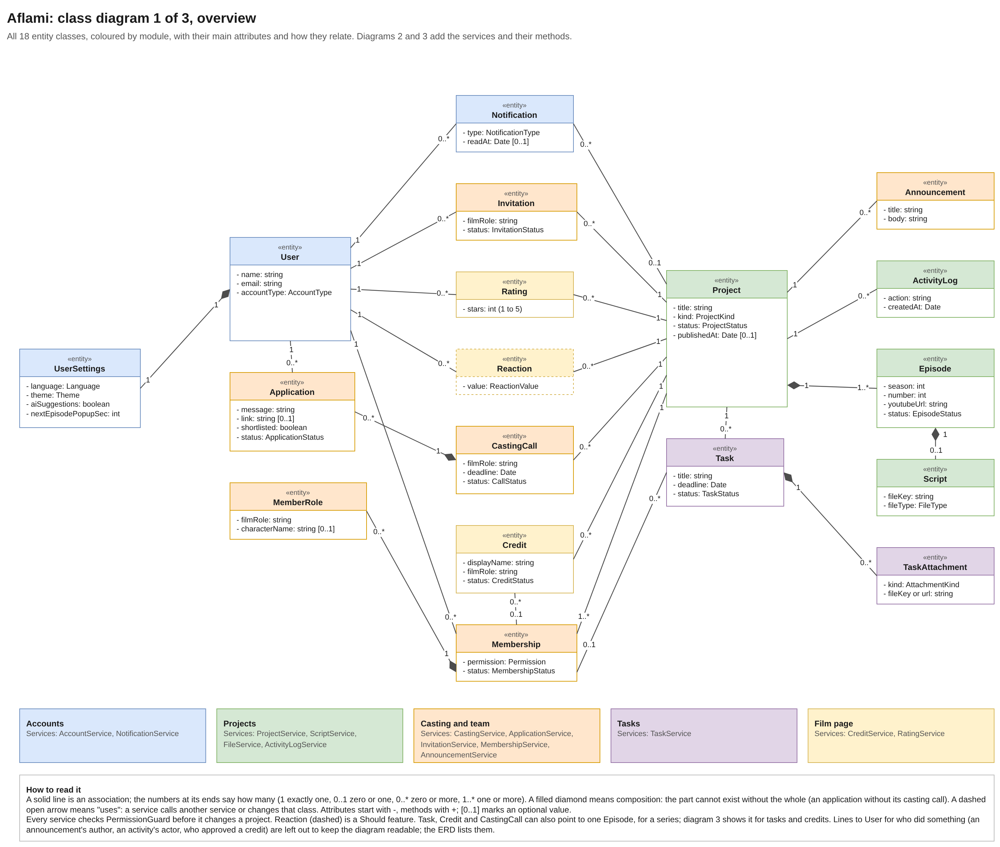
2. Casting and team: 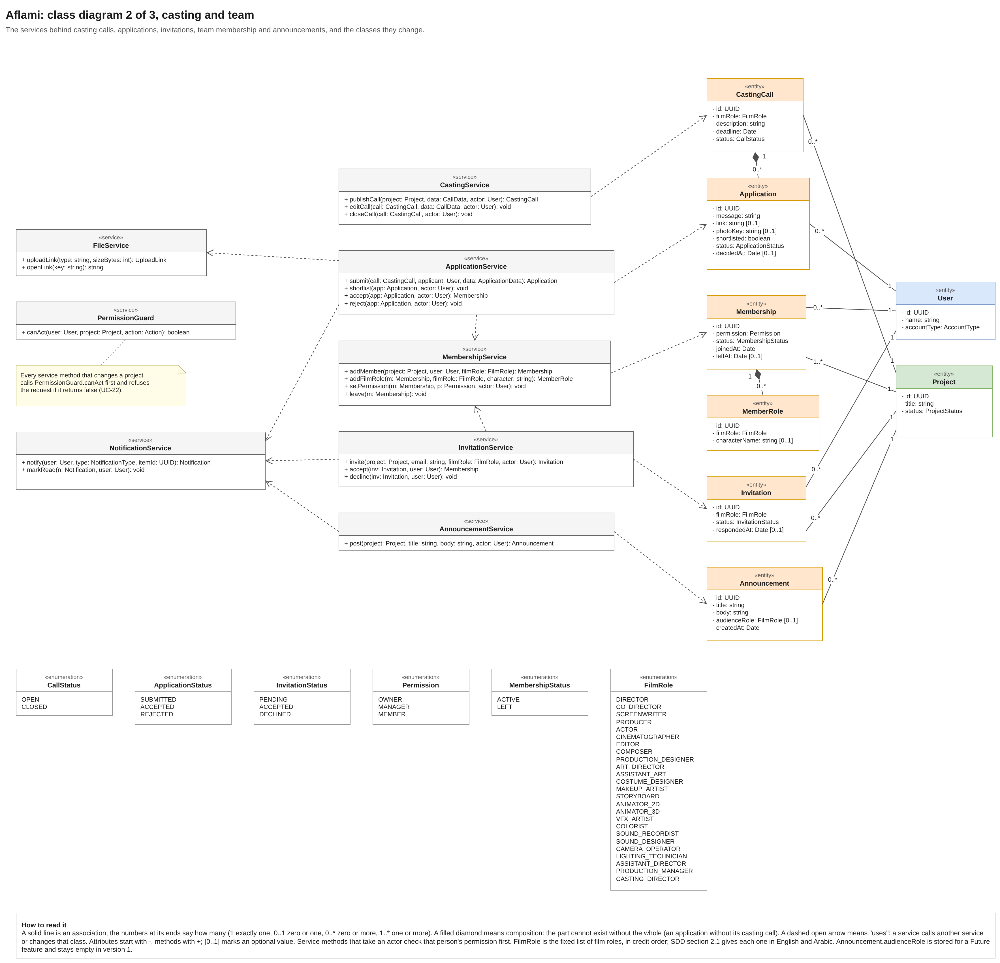
3. Tasks, credits and publishing: 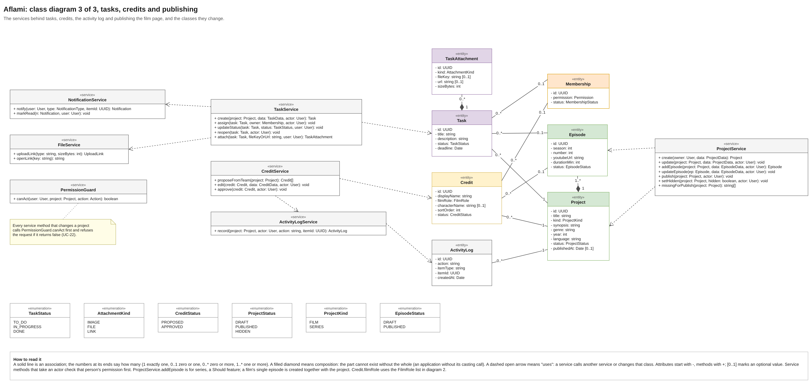

Sources: `design/diagrams/Aflami_Class_Diagram.drawio`, `design/diagrams/Aflami_Class_Casting_Team.drawio`, `design/diagrams/Aflami_Class_Tasks_Credits.drawio`.
 
**Design rules.** Entity classes hold data; services hold the behaviour, one group of services per back-end module (section 1.1), plus a Shared module that all five use. Every service method that changes a project calls `PermissionGuard.canAct` first and refuses the request if it returns false (UC-22). Composition (a filled diamond) marks a part that cannot exist without its whole: an application without its casting call, a member role without its membership, an attachment without its task, an episode without its project, a script without its episode, and a user's settings without the user.
 
**Services and their methods.** Sequence diagrams use exactly these names. The table lists the methods that change data; simple reads (a list of my projects, a film page) are queries in the same service and are left out.
 
| Service | Module | Methods |
| --- | --- | --- |
| PermissionGuard | Shared | canAct(user, project, action): boolean (user is empty for a visitor; SD-4 shows how it decides) |
| NotificationService | Shared | notify(user, type, itemId): Notification; markRead(notification, user): void |
| FileService | Shared | uploadLink(type, sizeBytes): UploadLink (checks the type and size, then a signed link for one upload); openLink(key): string (a link that expires) |
| ActivityLogService | Shared | record(project, actor, action, itemId): ActivityLog |
| AccountService | Accounts | register(data): User; signIn(email, password): Session; signOut(session): void; changePassword(user, oldPassword, newPassword): void; becomeCreator(user): void; updateSettings(user, data): UserSettings |
| ProjectService | Projects | create(owner, data): Project (also creates the film's single episode); update(project, data, actor): void; addEpisode(project, data, actor): Episode (series, Should); updateEpisode(episode, data, actor): void (details and YouTube link); publishEpisode(episode, actor): void (series, Should); publish(project, actor): void; setHidden(project, hidden, actor): void; missingForPublish(project): string[] |
| ScriptService | Projects | upload(episode, fileKey, actor): Script (replaces the previous script) |
| CastingService | Casting and team | publishCall(project, data, actor): CastingCall; editCall(call, data, actor): void; closeCall(call, actor): void |
| ApplicationService | Casting and team | submit(call, applicant, data): Application; shortlist(app, actor): void; unshortlist(app, actor): void; accept(app, actor): Membership; reject(app, actor): void |
| InvitationService | Casting and team | invite(project, email, filmRole, actor): Invitation; accept(inv, user): Membership; decline(inv, user): void |
| MembershipService | Casting and team | addMember(project, user, filmRole): Membership; addFilmRole(membership, filmRole, character): MemberRole; setPermission(membership, permission, actor): void; leave(membership): void (Should) |
| AnnouncementService | Casting and team | post(project, title, body, actor): Announcement (notifies every active member) |
| TaskService | Tasks | create(project, data, actor): Task; assign(task, owner, actor): void; updateStatus(task, status, user): void; reopen(task, actor): void; attach(task, fileKeyOrUrl, user): TaskAttachment |
| CreditService | Film page | proposeFromTeam(project, actor): Credit[] (in the order of the film role list); add(project, data, actor): Credit (someone without an Aflami account, Should); edit(credit, data, actor): void; approve(credit, actor): void; remove(credit, actor): void (a Proposed line only) |
| RatingService | Film page | rate(project, user, stars): Rating (Should); react(project, user, value): Reaction (Should) |
 
*The use cases' supporting steps map onto these methods: UC-17 Upload a file is `FileService.uploadLink`, after which the browser uploads the file itself, UC-20 Notify a user is `NotificationService.notify`, UC-21 Add a team member is `MembershipService.addMember`, and UC-22 Check permission is `PermissionGuard.canAct`.*
 
### 3.1 Design decisions

**DD-20 Entity classes hold data; services hold the behaviour.**

- *Why:* this is how NestJS is built (services are its providers). Each rule lives in one service method that a test can call directly, and the sequence diagrams in section 6 call the same methods.
- *Not chosen:* putting behaviour inside the entity classes, which mixes rules with database code and makes each rule harder to test alone.
- *Cost we accept:* the entity classes look thin, and the rules are found in the services.

**DD-21 Every method that changes data takes the actor.**

- *Why:* the permission check (DD-03) and the activity log both need to know who acts. Passing the actor makes this visible in every method and easy to test: a test calls the same method as a member and as a manager and expects different results.
- *Not chosen:* reading the current user from a hidden global inside each service, which tests cannot see or replace.
- *Cost we accept:* one more parameter on most methods.

**DD-22 One method for each action, not one general update.**

- *Why:* accept, reject, shortlist, reopen, approve and publish each have their own permission rule and their own change of state. Separate methods map one to one onto the use cases and the state diagrams, and each can be refused on its own.
- *Not chosen:* a general `update(status)`, which would let a request jump a record to any state.
- *Cost we accept:* more methods to write and document.

**DD-23 Composition only where a part cannot outlive its whole.**

- *Why:* an application without its casting call, a member role without its membership, an attachment without its task, an episode without its project, a script without its episode and settings without their user have no meaning. Deleting the whole deletes its parts in the database, which also serves the retention rules (NFR-PRV-06).
- *Not chosen:* composition everywhere, which would delete tasks and credits when a member leaves; memberships are kept instead (DD-12).
- *Cost we accept:* each composition must be declared as a delete rule on its foreign key.

**DD-24 Three class diagrams: an overview and two details.**

- *Why:* eighteen entity classes and fifteen services on one page cannot be read. The overview shows how all the data fits together, and the two details open up the areas with the most rules (casting and team; tasks, credits and publishing), the same split as the use case diagrams.
- *Not chosen:* one diagram with everything, or one diagram per module, which would hide the links between modules.
- *Cost we accept:* some classes appear in more than one diagram, so a change must be made in each.

Covers: FR-ACC-02, FR-ACC-03, FR-CST-01, FR-CST-02, FR-TEAM-02, FR-TSK-01, FR-TSK-02, FR-FILM-01, FR-FILM-03.
 
## 4 Main workflow (activity diagram)

The activity diagram follows one film from the new project to the public page, with a lane for each actor: Applicant or invitee, System, Owner or Manager, Member, Visitor or Viewer.

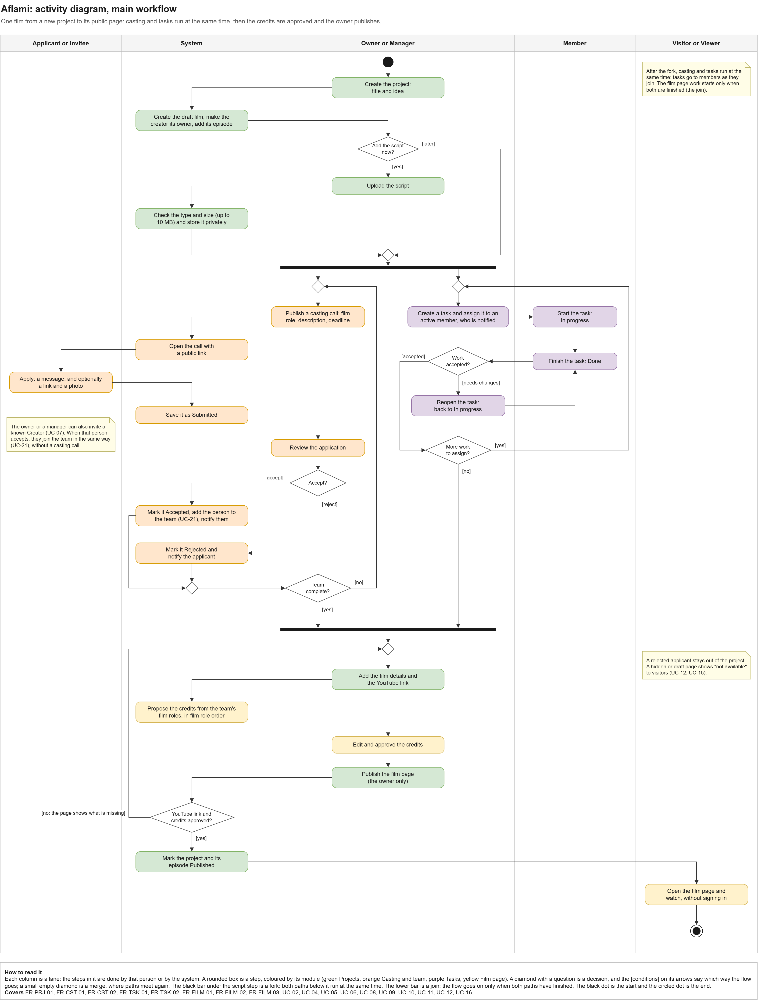

Source: `design/diagrams/Aflami_Activity_Main_Workflow.drawio`.

1. The owner creates the project; the system creates the draft film, makes the creator its owner and adds its episode.
2. The script is uploaded now or later (UC-02, 4a); the system checks its type and size and stores it privately.
3. The flow splits, and casting and tasks run at the same time.
4. Casting: the owner or a manager publishes a casting call, the system opens it with a public link, and applicants apply.
5. **Decision:** accept or reject. An accepted person joins the team; a rejected applicant is notified. **Loop** until the team is complete.
6. Tasks: the owner or a manager assigns a task to an active member, who starts and finishes it. **Decision:** the work is accepted, or the task is reopened. **Loop** while there is more work.
7. When both paths are finished, the owner adds the film details and the YouTube link.
8. The system proposes the credits in film role order; the owner or a manager edits and approves them.
9. The owner publishes. **Decision:** if the YouTube link or an approval is missing, the page shows what is missing.
10. The project and its episode become Published, and anyone can watch the film without signing in.

An invited Creator joins the team the same way as an accepted applicant (UC-07, UC-21), without a casting call.

Covers: FR-PRJ-01, FR-CST-01, FR-CST-02, FR-TSK-01, FR-TSK-02, FR-FILM-01, FR-FILM-02, FR-FILM-03.

## 5 Record states (state diagrams)
 
The state diagrams follow the MVP journey: create the project, build the team, distribute the work, publish the film. The overview shows the whole journey on one page and names the detailed diagram for each step; the supervisor asked at minimum for application, task and credit, which diagrams 1 to 3 cover, and diagram 4 adds the project and its film page, because publishing belongs to the project, not to the credits. Each diagram shows the saved status of each record, the order a team usually follows, and every condition, refusal and Should feature on the way; each transition says what triggers it, who may trigger it, its condition and what the system does.

1. Overview, the whole journey: 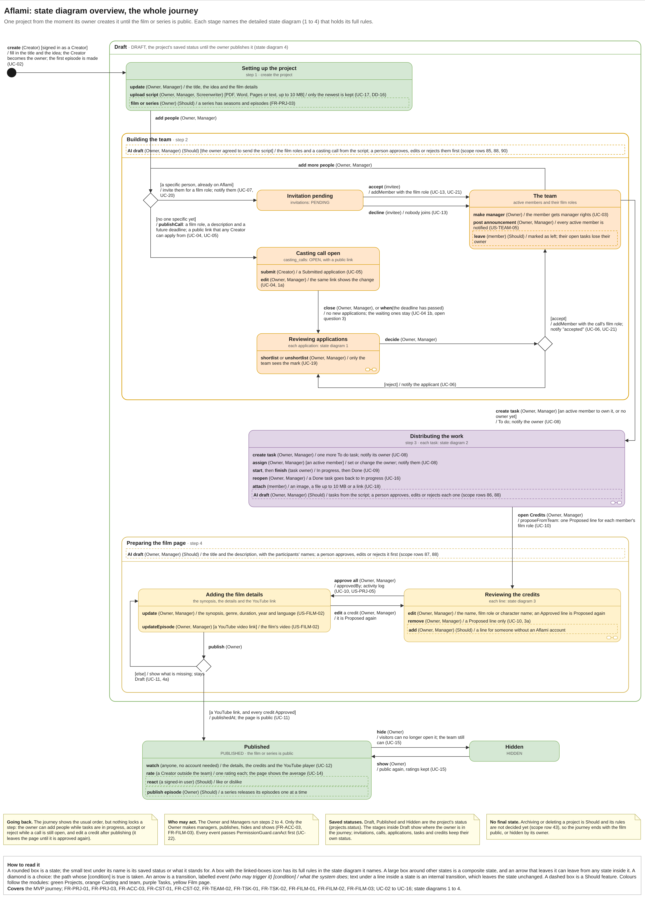
2. Diagram 1, building the team (invitations, casting calls and applications): 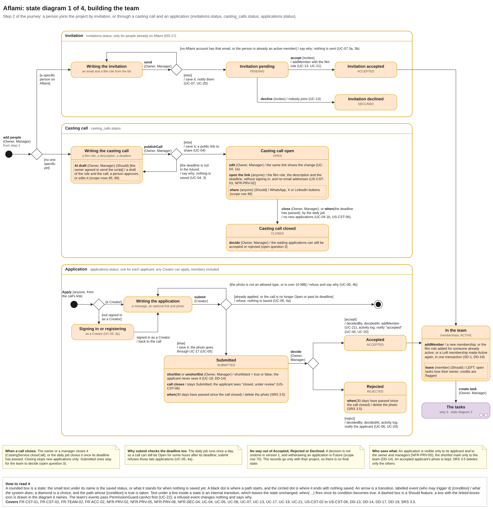
3. Diagram 2, distributing the work (one task, and the project's task list until every task is Done): 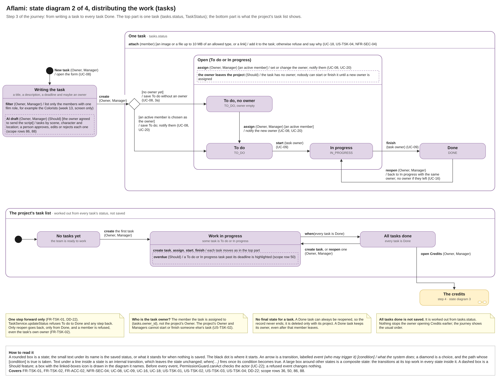
4. Diagram 3, the credits (one line, and the whole list until every line is Approved): 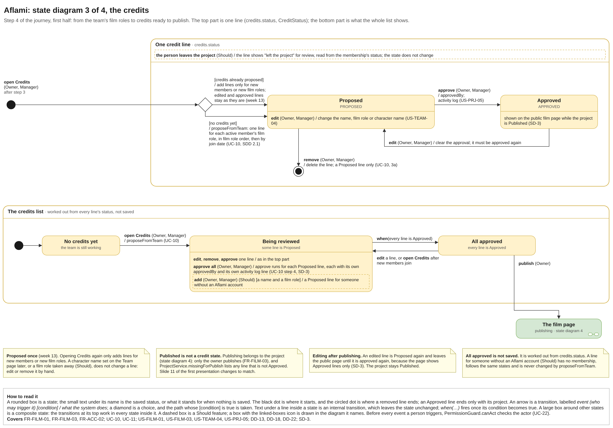
5. Diagram 4, project and film page: 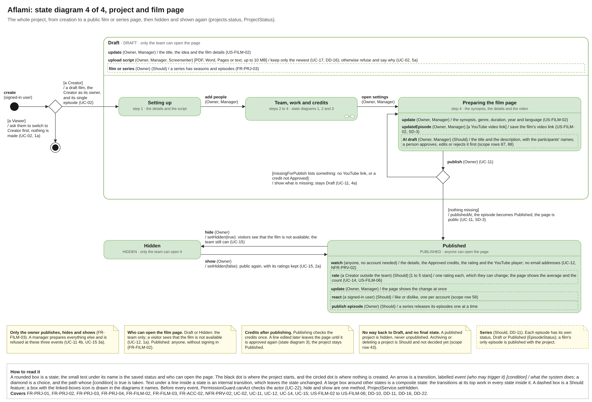

Sources: `design/diagrams/Aflami_State_Overview.drawio`, `Aflami_State_Application.drawio`, `Aflami_State_Task.drawio`, `Aflami_State_Credit.drawio` and `Aflami_State_Project.drawio`.

Stages such as "Writing the task", "All tasks done" or "All approved" are steps of the journey, not saved values: each diagram says so in grey under the state's name. The table sums up the saved transitions of every record.
 
| Record | From | Event (who) | To | Effect |
| --- | --- | --- | --- | --- |
| Application | Submitted | Accept (Owner, Manager) | Accepted | Creates the membership, or adds the film role if already a member |
| Application | Submitted | Reject (Owner, Manager) | Rejected | Applicant sees the result |
| Application | Submitted | Shortlist or unshortlist (Owner, Manager) | Submitted | Only the team sees the mark |
| Task | To do | Start (task owner) | In progress | — |
| Task | In progress | Finish (task owner) | Done | — |
| Credit | Proposed | Approve (Owner, Manager) | Approved | Records who approved |
| Credit | Approved | Edit (Owner, Manager) | Proposed | Must be approved again before the page is published |
| Credit | Proposed | Remove (Owner, Manager) | (deleted) | Only a Proposed line can be removed |
| Membership | Active | Leave (member, or Owner) | Left | Their open tasks lose their owner; their credits are flagged for review |
| Invitation | Pending | Accept or decline (invitee) | Accepted or Declined | Accept creates the membership |
| Project | Draft | Publish (Owner) | Published | Needs a YouTube link and approved credits |
| Project | Published | Hide or show (Owner) | Hidden, or back to Published | The page leaves or returns to public view |
| Casting call | Open | Close (Owner, Manager) | Closed | Stops new applications; Submitted applications stay as they are |
| Task | Done | Reopen (Owner, Manager) | In progress | — |
| Episode | Draft | Publish (Owner) | Published | A series can release one episode at a time; a film's only episode is published with the project |
 
*Note: the first presentation showed Published as a credit state. In this design, publishing belongs to the project, so slide 11 changes in week 14.*
 
*Decided in week 12: closing a call leaves Submitted applications as they are, and the owner or a manager can reopen a Done task.*

*Decided in week 13: editing an Approved credit sends it back to Proposed; credits are proposed once, and opening Credits again only adds lines for new members or film roles; a person who left a project and is accepted again has their membership made Active again.*

*Week 13 review of the state diagrams: submit also checks the call's deadline, because the daily job may close a call some hours after it; a shortlist mark can be removed; a reopened task whose owner has left has no owner until one is assigned; overdue is worked out from the deadline and is not a status.*
 
Covers: FR-PRJ-01, FR-CST-01, FR-CST-02, FR-TEAM-02, FR-TSK-01, FR-TSK-02, FR-FILM-01, FR-FILM-02, FR-FILM-03, NFR-PRV-05, NFR-PRV-06.
 
## 6 Key scenarios (sequence diagrams)
 
Four scenarios only, as the supervisor asked: the three flows that make Aflami different, plus the permission check that guards them all. Each diagram uses the class and method names of section 3 and shows the refusal path as an `alt` fragment. Words in quotes are values whose exact names are set in the code: the actions passed to `PermissionGuard.canAct` ("accept", "create task", "update task", "reopen task", "credits", "approve credits", "edit film page", "publish") and the notification types ("accepted", "task assigned").
 
### SD-1 Accept an applicant (Abdullah)

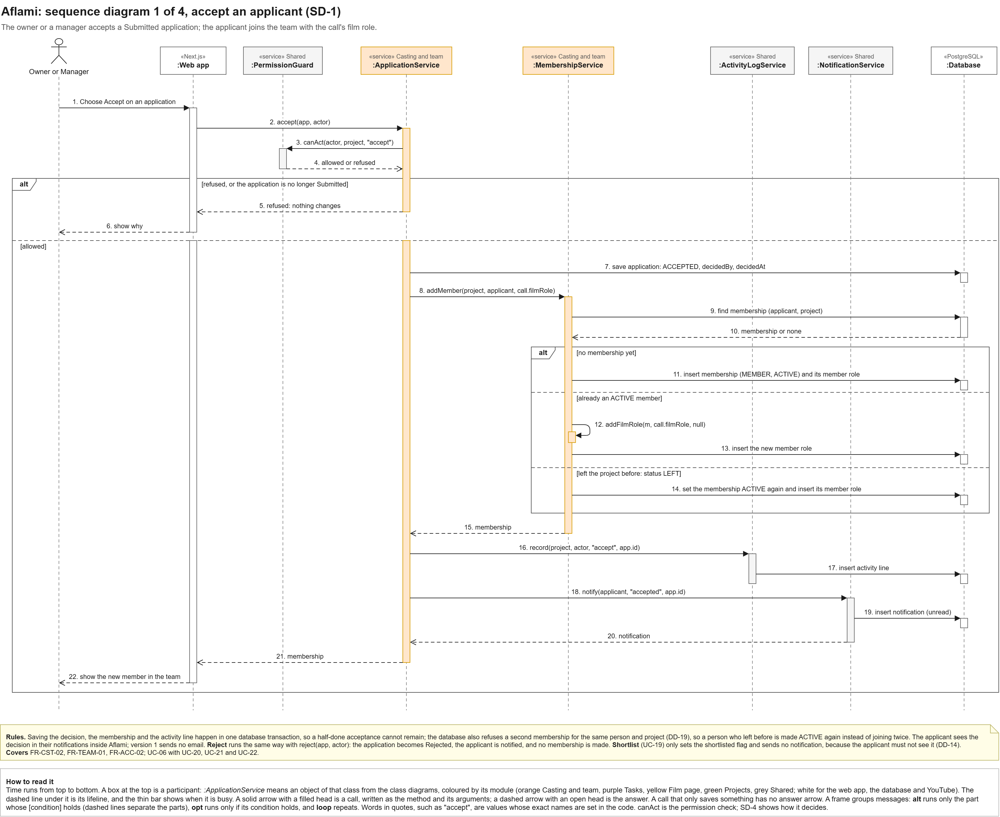

Source: `design/diagrams/Aflami_Sequence_SD1_Accept_Applicant.drawio`.

Participants: Owner or Manager, Web app, PermissionGuard, ApplicationService, MembershipService, ActivityLogService, NotificationService, Database.

1. The owner or a manager chooses Accept, and the web app calls `ApplicationService.accept(app, actor)`.
2. `PermissionGuard.canAct` checks the action "accept". If it is refused, or the application is no longer Submitted, nothing changes.
3. In one transaction, the application becomes Accepted with who decided and when, and `MembershipService.addMember` adds the person: a new membership; a new film role for someone already active; or, for someone who left the project before, the same membership made Active again. The activity log records the decision.
4. `NotificationService.notify` tells the applicant, and the web app shows the new member in the team.

Covers: FR-CST-02, FR-TEAM-01, FR-ACC-02.

### SD-2 Assign a task and update it (Abdullah)

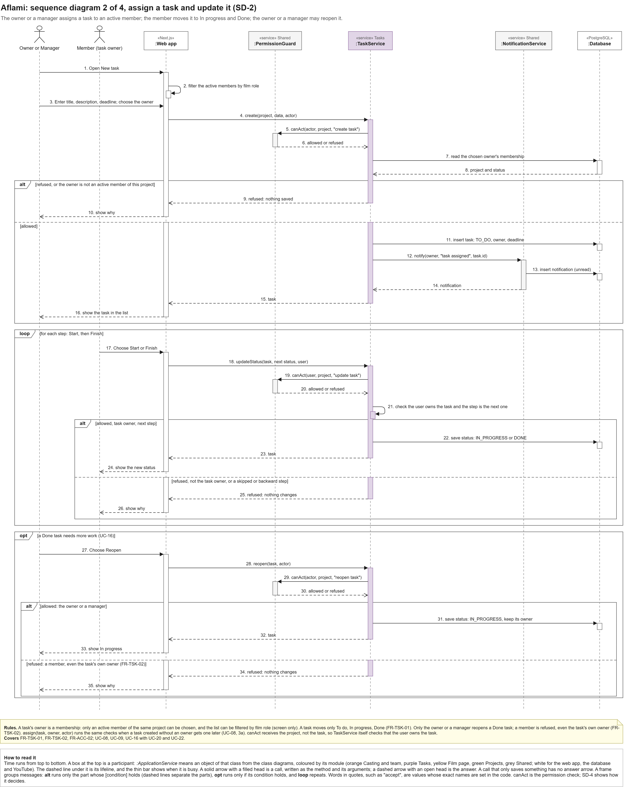

Source: `design/diagrams/Aflami_Sequence_SD2_Assign_Task.drawio`.

Participants: Owner or Manager, Member (task owner), Web app, PermissionGuard, TaskService, NotificationService, Database.

1. The owner or a manager opens New task, filters the active members by film role and chooses the owner. `TaskService.create` checks the action "create task" and that the owner is an active member of the project; a refused request saves nothing.
2. The task is saved as To do, and `NotificationService.notify` tells its owner.
3. The member starts, then finishes the task (`updateStatus`). `TaskService` checks that this member owns the task and that the status moves one step forward.
4. The owner or a manager can reopen a Done task (`reopen`), which goes back to In progress with the same owner; a member is refused, even the task's own owner.

Covers: FR-TSK-01, FR-TSK-02, FR-ACC-02.

### SD-3 Approve the credits and publish the film page (Abdullah)

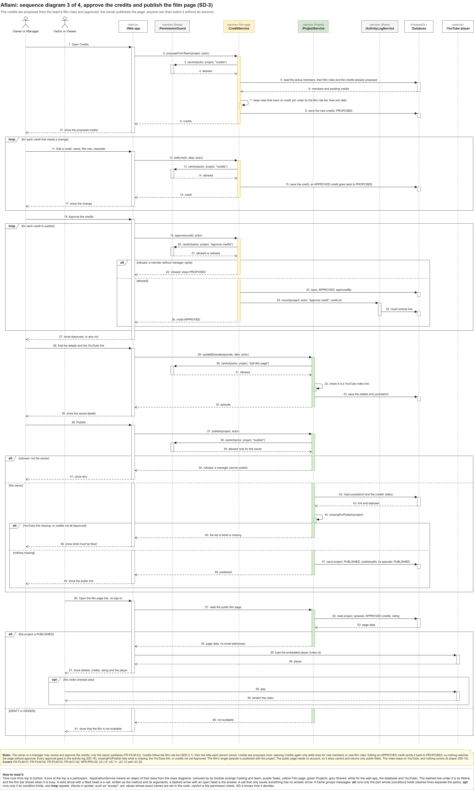

Source: `design/diagrams/Aflami_Sequence_SD3_Credits_Publish.drawio`.

Participants: Owner or Manager, Visitor or Viewer, Web app, PermissionGuard, CreditService, ProjectService, ActivityLogService, Database, YouTube player.

1. `CreditService.proposeFromTeam(project, actor)` proposes the credits once, from the active members' film roles, in film role order; opening Credits again only adds lines for new members or film roles.
2. The owner or a manager edits the credits that need it (an edited Approved credit goes back to Proposed) and approves them; every approval is written to the activity log.
3. `ProjectService.updateEpisode` saves the film details and the YouTube link, after checking that the link is a YouTube video.
4. `ProjectService.publish` is allowed for the owner only. `missingForPublish` lists anything missing; otherwise the project and its episode become Published.
5. Anyone opens the page without signing in: a published page shows the details, the credits, the rating and the YouTube player; a draft or hidden page shows that the film is not available.

Covers: FR-FILM-01, FR-FILM-02, FR-FILM-03, FR-ACC-02, NFR-PRV-02.

### SD-4 Permission check on any request (Anas)

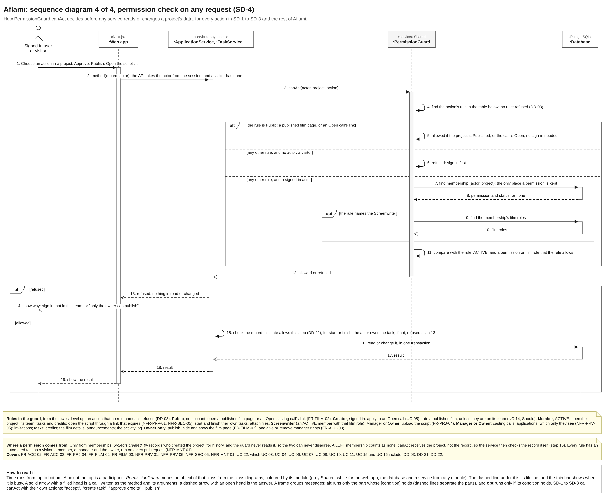

Source: `design/diagrams/Aflami_Sequence_SD4_Permission_Check.drawio`.

Participants: Signed-in user or visitor, Web app, a service of any module, PermissionGuard, Database.

1. The user chooses an action in a project, and the web app calls the service method with the actor, which the API takes from the session; a visitor has none.
2. The service calls `PermissionGuard.canAct(actor, project, action)`, which finds the action's rule in the table below; an action that no rule names is refused (DD-03).
3. A Public rule needs no sign-in. Any other rule refuses a visitor; for a signed-in actor, the guard reads the actor's membership in the project, and its film roles when the rule names the Screenwriter, and compares them with the rule.
4. Refused: nothing is read or changed, and the web app says why. Allowed: the service checks the record itself (its state, and for start or finish that the actor owns the task), then reads or changes it in one transaction.

| Level | Who | Actions |
| --- | --- | --- |
| Public | Anyone, without an account | Open a published film page, or an Open casting call's link |
| Creator | A signed-in Creator | Apply to an Open call (UC-05); rate a published film, unless on its team (UC-14, Should) |
| Member | An ACTIVE member | Open the project, its team, tasks and credits; open the script through a link that expires; start and finish their own tasks; attach files |
| Screenwriter | An ACTIVE member with the Screenwriter film role, a Manager or the Owner | Upload the script (FR-PRJ-04) |
| Manager | A Manager or the Owner | Casting calls; applications; invitations; create, assign and reopen tasks; credits; film details; announcements; the activity log |
| Owner | The Owner only | Publish, hide and show the film page; give or remove manager rights |

*A permission comes only from memberships. `projects.created_by` records who created the project, for history; the guard never reads it, so the two cannot disagree. A LEFT membership counts as none. Should features take the level of the area they belong to.*

The [permission prototype plan](Aflami_Permission_Prototype_Plan.md) turns this table into 76 automated tests on the real stack, before CPIT-499.

Covers: FR-ACC-02, FR-ACC-03, FR-PRJ-04, FR-FILM-02, FR-FILM-03, NFR-PRV-01, NFR-PRV-05, NFR-SEC-05, NFR-MNT-01.

## 7 Diagram checklist and consistency checks
 
Seven diagram types make the full set the supervisor asked for; tick each when its image and its "Covers" line are in place.
 
- [x] Use case diagram, in the SRS section 3.2 (Anas, week 12)
- [x] ERD, section 2 (Anas, week 12)
- [x] Component and deployment diagrams, section 1 (Anas, week 13)
- [x] Class diagram, section 3 (Anas, week 13)
- [x] Activity diagram, section 4 (Abdullah, week 13)
- [x] State diagrams: the journey overview, and diagrams 1 to 4 for the team, the tasks, the credits and the project, section 5 (Abdullah, week 13)
- [x] Sequence diagrams SD-1 to SD-3 (Abdullah) and SD-4 (Anas), section 6 (week 13)
- [x] Screen designs, first drafts, section 8 (week 13)

## 8 Screen designs (first drafts)

These are the first drafts of the main screens, made in week 13 to agree on the look and the flow before CPIT-499. They are drafts: the layouts, the pictures (empty character slots, to be drawn by Anas) and the phone layouts are refined while building. Every screen is Arabic first and right to left, in a dark appearance by default. Red is Aflami's colour; each part of the journey has its own: projects green, casting blue, tasks orange, credits and the film page indigo, the viewer pages yellow, the profile violet.

| # | Screen | Image | Use cases |
| --- | --- | --- | --- |
| 1 | Sign in and sign up | [Aflami_UI_01_SignIn.png](../../design/wireframes/Aflami_UI_01_SignIn.png) | UC-01 |
| 1b | Choosing the account type | [Aflami_UI_01b_AccountType.png](../../design/wireframes/Aflami_UI_01b_AccountType.png) | UC-01 |
| 2 | My projects | [Aflami_UI_02_Projects.png](../../design/wireframes/Aflami_UI_02_Projects.png) | UC-02 |
| 3 | New project | [Aflami_UI_03_NewProject.png](../../design/wireframes/Aflami_UI_03_NewProject.png) | UC-02, UC-17 |
| 4 | Project overview and script | [Aflami_UI_04_Overview.png](../../design/wireframes/Aflami_UI_04_Overview.png) | UC-02, UC-17 |
| 5 | Team and invitations | [Aflami_UI_05_Team.png](../../design/wireframes/Aflami_UI_05_Team.png) | UC-03, UC-07 |
| 6 | New casting call | [Aflami_UI_06_NewCall.png](../../design/wireframes/Aflami_UI_06_NewCall.png) | UC-04 |
| 7 | Public casting call | [Aflami_UI_07_CallPublic.png](../../design/wireframes/Aflami_UI_07_CallPublic.png) | UC-04, UC-05 |
| 8 | Apply | [Aflami_UI_08_Apply.png](../../design/wireframes/Aflami_UI_08_Apply.png) | UC-05, UC-17 |
| 9 | Reviewing applications | [Aflami_UI_09_Applications.png](../../design/wireframes/Aflami_UI_09_Applications.png) | UC-06, UC-19, UC-21 |
| 10 | Tasks | [Aflami_UI_10_Tasks.png](../../design/wireframes/Aflami_UI_10_Tasks.png) | UC-09, UC-16, UC-18 |
| 11 | New task | [Aflami_UI_11_NewTask.png](../../design/wireframes/Aflami_UI_11_NewTask.png) | UC-08 |
| 12 | Credits review | [Aflami_UI_12_Credits.png](../../design/wireframes/Aflami_UI_12_Credits.png) | UC-10 |
| 13 | Film page settings and publishing | [Aflami_UI_13_FilmSettings.png](../../design/wireframes/Aflami_UI_13_FilmSettings.png) | UC-11, UC-15 |
| 14 | Activity log | [Aflami_UI_14_Activity.png](../../design/wireframes/Aflami_UI_14_Activity.png) | — |
| 15 | Notifications and invitations | [Aflami_UI_15_Notifications.png](../../design/wireframes/Aflami_UI_15_Notifications.png) | UC-13, UC-20 |
| 16 | Account settings | [Aflami_UI_16_Settings.png](../../design/wireframes/Aflami_UI_16_Settings.png) | — |
| 17 | Creator profile (Should) | [Aflami_UI_17_Profile.png](../../design/wireframes/Aflami_UI_17_Profile.png) | — |
| V1 | Home (viewer side) | [Aflami_UI_V1_Home.png](../../design/wireframes/Aflami_UI_V1_Home.png) | UC-12 |
| V2 | Film page, overview tab | [Aflami_UI_V2_Film.png](../../design/wireframes/Aflami_UI_V2_Film.png) | UC-12, UC-14 (Should) |
| V3 | Film page, credits tab | [Aflami_UI_V3_FilmCredits.png](../../design/wireframes/Aflami_UI_V3_FilmCredits.png) | UC-12 |
| V4 | Home in the light appearance (Should) | [Aflami_UI_V4_HomeLight.png](../../design/wireframes/Aflami_UI_V4_HomeLight.png) | — |
| V5 | Film page with the English interface | [Aflami_UI_V5_FilmEnglish.png](../../design/wireframes/Aflami_UI_V5_FilmEnglish.png) | UC-12 |
| S1 | Colours: red, and a colour per section | [Aflami_UI_S1_Colours.png](../../design/wireframes/Aflami_UI_S1_Colours.png) | — |

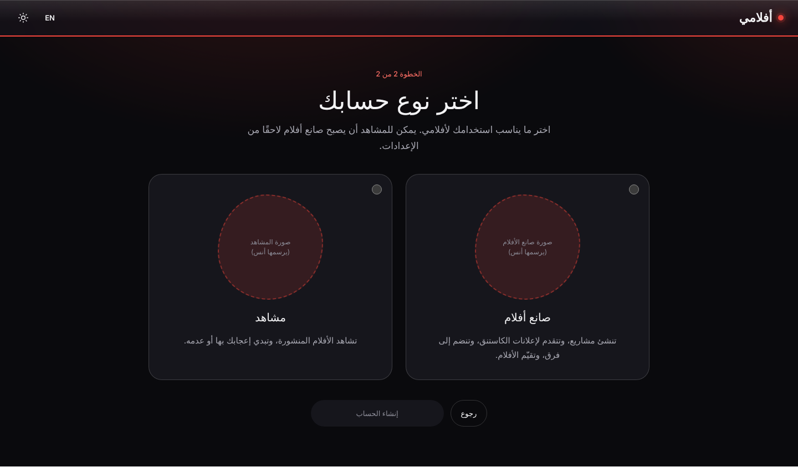

Covers: NFR-USA-01, NFR-USA-03, NFR-USA-04.
