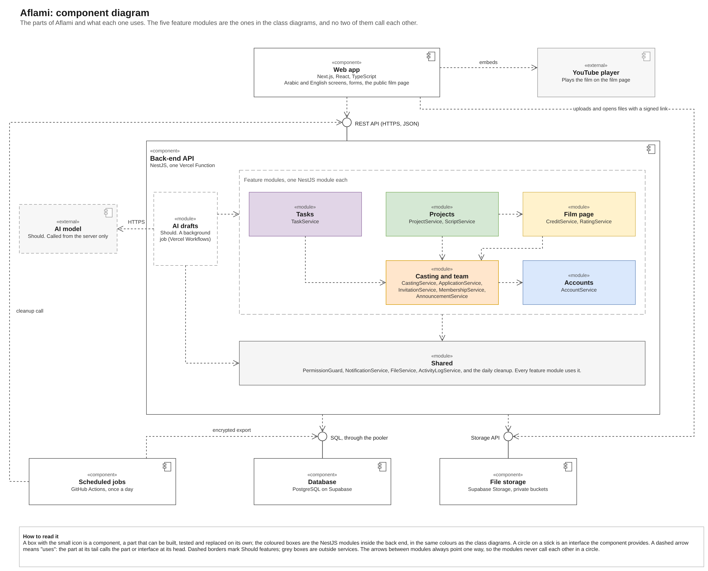

# Aflami revised proposal

Aflami (أفلامي) is an Arabic-first web platform for student and independent short-film teams. A team creates its project, casts its members, distributes the tasks and publishes a film page with full credits, all in one place. This revised proposal updates the first presentation with what CPIT-498 has decided and designed since. It also sets the plan for building and evaluating Aflami in CPIT-499.

| Field | Value |
| --- | --- |
| Course | CPIT-498 (design), built in CPIT-499 |
| Authors | Anas Azib, Abdullah Al-Jadani |
| Supervisor | Prof. Adeeb Rida Noor |
| Version | Revised proposal, for the supervisor's review (week 13) |
| Details | [Software Requirements Specification](../requirements/Aflami_SRS.md) (SRS), [Software Design Document](../design/Aflami_SDD.md) (SDD), [hosting plan and risks](Aflami_Hosting_and_Risks.md) |

| Section | Owner |
| --- | --- |
| 1 Introduction, 3 Scope, 4 Design, 6 Plan and timeline, 8 to 10 | Both |
| 2 Previous studies, 5 Evaluation plan | Abdullah |
| 7 Hosting and risks | Anas |

## 1 Introduction

### 1.1 Problem

Student and independent filmmakers run a short film through chats, files and social media, and each tool holds only one part of it:

- **Scattered materials.** The idea, the script and the files are spread across WhatsApp, Word files and Google Drive.
- **Casting buried in messages.** Casting calls go out on Instagram, Facebook or LinkedIn, and applications come back as direct messages and comments.
- **Tasks with no owner.** Tasks and call times live in chat messages, so it is hard to tell who owns what, or when it is due.
- **Forgotten credits.** Credits are often typed from memory when the film is released, so contributors can be left out.

This affects film teams of students and independent creators in Saudi Arabia. Our first planned users are student filmmakers and university film clubs.

### 1.2 Proposed solution

Aflami brings the four steps of a short film into one guided journey, with one linked record from the first application to the last credit:

1. **Create the project.** Add the idea, the details and the script. Only the team's active members can open the script.
2. **Build the team.** Publish casting calls with a public link, receive applications in one place, and accept or reject each one; or invite a person who is already on Aflami. An accepted person joins the project with their film roles.
3. **Distribute the work.** Every task has one owner, a status (To do, In progress, Done) and a deadline.
4. **Publish the film.** Aflami proposes the credits from the team. The owner or a manager edits and approves them, and the owner publishes a film page with the YouTube video and the approved credits.

Aflami has three kinds of user. A **Visitor** has no account and watches published film pages. A **Viewer** has an account. A **Creator** can create projects, apply to casting calls and join teams. Inside each project, a Creator is the **Owner**, a **Manager** or a **Member**. Managers (there can be several) do everything except publishing and giving permissions, which stay with the owner.

### 1.3 Aims

| # | Aim | How we build it |
| --- | --- | --- |
| 1 | Give a film team one workspace for its project, script, team, tasks and film page | Web app: Next.js, NestJS, PostgreSQL |
| 2 | Bring casting into the project: an accepted applicant joins with their film roles and that project's permissions | Role-based access control per project |
| 3 | Give the team an approval flow: the owner or a manager accepts applicants, follows the tasks and approves the credits; only the owner publishes | Workflow and state logic, with an activity log |
| 4 | Publish a film page that embeds the YouTube video and builds the credits from the team | YouTube embedded player |
| 5 | Evaluate Aflami with two real filmmaker teams: time per step, completion without help, errors | Usability tests and logged measures (section 5) |

### 1.4 What changed since the first proposal

- The second permission level is called **Manager**, not director, so it never clashes with the film role Director. A project can have several managers.
- Accounts are **Viewer** or **Creator**, chosen on its own screen at sign-up; a Viewer can become a Creator later. Visitors watch published pages without an account.
- **Invitations** to people already on Aflami were added beside casting calls, and any Creator can apply to a casting call.
- A credit is **Proposed** or **Approved**; the public page shows the approved credits. There is no separate "Published" state for a credit.
- The **star rating** moved from Must to Should (supervisor's review, Nov 24), because it is outside the main journey. **Series** are stored in the database from version 1, and the series pages are Should.
- **AI drafts** from the script (roles and casting ad, tasks, title and description) are Should features, as the supervisor confirmed in week 13. A person approves, edits or rejects every draft.
- **Hosting** is decided: Supabase, Vercel and GitHub Actions on free plans, with an encrypted daily backup kept in a private repository (section 7).
- The review of similar products grew to 13 products, including Saudi and Arabic platforms (section 2).

## 2 Previous studies

We searched for products that cover any part of Aflami's journey and recorded every search: the words, where we searched, the date and what we found. The [search log](previous-studies/Aflami_Search_Log.pdf) holds 12 searches made on 17 and 18 November 2026: 8 on Google, 3 on the App Store and 1 on Google Play. Its [addendum](previous-studies/Aflami_Search_Log_Addendum.md) records search 13, on 25 November, which finds Castpace. The [platform comparison](previous-studies/Aflami_Similar_Platforms_Comparison.pdf) then reviewed 13 products on their own public pages:

| Group | Products |
| --- | --- |
| Film production management | StudioBinder, InteScene, Celtx |
| Casting and talent marketplaces | Backstage, Casting Call Club |
| Filmmaker networks and talent resources | FILMD, Team4set, Filmmakers System |
| Saudi and regional platforms | Casta (Saudi), ProdCrew (Arabic), Castpace (Cairo, 2013; current status not confirmed) |
| Local initiatives, not software competitors | Maflam (film education), Kader (the Saudi Film Commission's training program) |

The closest products, and what their public material did not show:

| Product | What it covers | Not found in its public material |
| --- | --- | --- |
| FILMD | Job posts and applicants, a production workspace with team permissions, and a Screening Room that links films to the people who made them. English, for the UK market; the production space is paid (FILMD Plus, £8.25 a month, £49 a year for students) | An Arabic interface; a workflow for student and independent short films from the accepted applicant to the task owner and the approved credit |
| InteScene | Production management for professional companies: team, task boards, scheduling and a credits generator | Open casting calls that people outside the team apply to; casting is not in its Free or Indie plans |
| Backstage, Casting Call Club | Casting calls, submissions and auditions | A project workspace with tasks and a film page with credits |
| StudioBinder, Celtx | Production planning: scripts, schedules, contacts and tasks | Public casting applications, and a film page with credits |
| Casta | A Saudi casting app: casting calls, applications, bookings and projects (as the search log describes it) | The chain from an accepted applicant to a team member, task owner and approved credit, and a public film page (to confirm on Casta's own pages) |
| ProdCrew | An Arabic platform where a filmmaker posts a project and finds actors and crew (as the search log describes it) | Task ownership, permissions per project, approved credits and a film page |
| Castpace | Hiring cast and crew together with project planning, for filmmakers in the region | Role-based teams, tasks with owners, approved credits and a film page; its current status could not be confirmed |

**What we do not claim.** Casting, task management and film credits each exist in other products. FILMD and InteScene already link a team, its work and its credits, and Casta and ProdCrew already offer casting with project handling in Saudi Arabia and the Arab region. So we do not claim that no platform connects these steps, or that no Saudi or Arabic platform does casting with projects.

**Aflami's contribution.** A focused, Arabic-first workflow for student and independent short-film teams. One record connects the casting application, the role-based team membership, the task assignment, the approved credits and the public film page. Version 1's evaluation with two real teams (section 5) tests whether this helps them.

**Limits.** The review uses public pages read on 17 and 18 November 2026. "Not found" does not prove that a product lacks a feature. Casta and ProdCrew are described only as the search log describes them. We recheck the products before the final presentation, because services and plans change.

## 3 Scope of version 1

Each feature has one of three levels. **Must** is part of version 1, and the CPIT-499 build is not finished without it. **Should** is built only after every Must feature works. **Future** is not in version 1. The full table, with every feature and its level, is SRS section 1.2; the reasons for each choice are in the [version 1 scope sheet](../requirements/Aflami%20Version%201%20Scope.xlsx).

| Area | Must (summary) |
| --- | --- |
| Accounts | Registration and sign-in with the account type; Owner, Manager and Member levels; notifications inside the site; my projects; change password |
| Projects and scripts | Create a project and upload the script (only the newest is kept); edit the project details |
| Casting and team | Casting calls with a public link; apply with a photo or a demo-reel link; shortlist, accept or reject; invitations; team page with film roles |
| Tasks | Create, assign and update tasks; reopen a done task; task attachments |
| Film page and credits | Credits proposed from the team, edited and approved; film page with the YouTube video, synopsis, details and credits; only the owner publishes; hide or show at any time |
| Interface | Arabic, right to left, on phone and desktop; an Arabic and English switch for the interface only; terms of use, privacy policy, help |

**Should features** include the star rating, series pages, likes, a public gallery of films, profiles with past credits, task comments and a board view, and the AI drafts.

**Success criterion.** Version 1 succeeds when two real filmmaker teams complete the whole journey on Aflami: create the project, build the team, finish the tasks and publish the film page.

## 4 Design summary

CPIT-498 produced the full design of version 1. The SRS (ISO/IEC/IEEE 29148) holds 35 user stories with acceptance criteria, 16 main and 6 supporting use cases with three use case diagrams, and the functional and non-functional requirements. Its traceability matrix (section 5.2) ties every Must requirement to its story, use case, diagrams and test. The SDD holds every other diagram:

- **Architecture.** One Next.js web app and one NestJS back end (a single Vercel Function), over a PostgreSQL database on Supabase, which also stores the files. The back end has five feature modules (Accounts, Projects, Casting and team, Tasks, Film page) and a Shared module. Files go straight between the browser and storage through signed links; the film video stays on YouTube.
- **Data model.** 18 tables in a crow's-foot ERD: 16 Must and 2 Should (ratings and reactions). The unique rules sit in the database, such as one membership per person and project. Every project has episodes and a film has exactly one, so series need no change to the tables later. The 25 film roles form a fixed list in credit order.
- **Permissions.** Every request passes one check, `PermissionGuard.canAct`, which refuses by default. A permission comes only from the person's membership in that project (sequence diagram SD-4 and its rules table).
- **Behaviour.** Three class diagrams with the services and their methods; the activity diagram of the main workflow; five state diagrams drawn as journeys, from a new project to a published film page; and four sequence diagrams (accept an applicant, assign a task, approve credits and publish, check a permission).
- **Design decisions.** DD-01 to DD-24 record why each choice was made, what we did not choose, and the cost we accept.
- **Screens.** First drafts of 23 screens and the colour sheet are in `design/wireframes/` (SDD section 8). They are refined in CPIT-499, with the phone layouts.

## 5 Evaluation plan

### 5.1 What we evaluate

The evaluation tests the success criterion in section 3 with real users. Two filmmaker teams use Aflami for a real short film, from creating the project to publishing the film page. It also checks two usability requirements: NFR-USA-01 (Arabic, right to left, on phone and desktop) and NFR-USA-02 (a first-time owner creates a project and publishes a casting call without help). It runs in CPIT-499 weeks 10 to 12, after the first integrated trial (section 6.2).

### 5.2 The two teams

We choose teams that meet all of these:

- A student or independent team making a short film whose production falls in the evaluation weeks.
- At least four people: the owner, at least one actor and at least two crew members.
- An owner who has not used Aflami before, so NFR-USA-02 can be measured.
- Arabic-speaking members, with at least one person on a phone and one on a computer.
- A film that will be on YouTube, public or unlisted, with embedding allowed (risk R-17).

We contact student film teams and university film clubs before CPIT-499 starts, and confirm two teams in its first weeks. A third team is kept in reserve (risk R-06). The reports name teams by type only (for example, "a student team of five"), to protect their privacy.

### 5.3 The steps we observe

| Step | What the team does | Who | Use cases |
| --- | --- | --- | --- |
| 1 Create | Register as a Creator, create the project and upload the script | Owner | UC-01, UC-02 |
| 2 Cast | Publish a casting call and share its link | Owner or a manager | UC-04 |
| 3 Apply and invite | People apply through the link; the owner invites a person already on Aflami, who accepts | Applicants, the invited person | UC-05, UC-07, UC-13 |
| 4 Build the team | Review the applications, accept or reject them, and give a member manager rights | Owner or a manager | UC-06, UC-03 |
| 5 Distribute the work | Create and assign tasks; the members move them to Done | Owner or a manager, members | UC-08, UC-09 |
| 6 Credits | Review and approve the proposed credits | Owner or a manager | UC-10 |
| 7 Publish | Publish the film page | Owner | UC-11 |
| 8 Watch | A person without an account opens the page and watches the film | Visitor | UC-12 |

### 5.4 How each team is evaluated

1. **Before.** Each participant signs a consent form. We explain the evaluation in ten minutes, but we do not train them on Aflami, because we measure completion without help.
2. **Session 1, observed (about an hour).** Steps 1 to 4, with the owner and two or three members, in person or by video call with screen sharing.
3. **During production, on their own.** Steps 4 and 5 continue while the team makes its film. Aflami's own records (the activity log and the task dates) give the time of each step.
4. **Session 2, observed (about 30 minutes).** Steps 6 to 8, then a short questionnaire and interview.

One of us observes and takes notes. We help only when a person asks, or after three minutes stuck on the same step, and we record every help.

### 5.5 Measures

| Measure | How we collect it | Checks |
| --- | --- | --- |
| Time per step | The observer's timer in the sessions; between sessions, the times Aflami saves (activity log, task dates) | Success criterion |
| Completion without help | For each step and person: done alone, done after a hint, done with help, or not done | Success criterion, NFR-USA-02 |
| Errors | The observer's notes and the server's error log. Each error is critical (data lost, private data seen, or a step that cannot be finished), major (the person needs help) or minor (the person recovers alone) | Success criterion |
| Device | Whether each step was done on a phone or a computer | NFR-USA-01 |
| Satisfaction | The System Usability Scale (SUS), ten standard questions in Arabic (reference 8), after session 2 | Section 5.6 |
| AI drafts (Should, only if built) | The share of drafts accepted as they are or with minor edits, from the AI log | Scope sheet targets |

### 5.6 Success criteria

| # | Criterion | Target |
| --- | --- | --- |
| 1 | Teams that complete the whole journey and publish their film page | Both teams |
| 2 | First-time owners who create the project and publish a casting call without help (NFR-USA-02) | Both owners |
| 3 | Steps done without help, across all attempts | At least 80% |
| 4 | Critical errors | None |
| 5 | Average SUS score | At least 68, the usual average for SUS (reference 9) |
| 6 | AI drafts accepted as they are or with minor edits (Should, only if built) | Roles and casting ad 70%, tasks 60%, title and description 70% |

### 5.7 Before the evaluation

- In week 9, we run the checks in SRS section 4 that come before the evaluation: the phone and right-to-left checklist with Arabic sample data (NFR-USA-03 to NFR-USA-07, NFR-PRT-01) and the load test (NFR-PERF-01).
- The first integrated trial in week 8 uses the same steps, forms and questionnaire, so the evaluation materials are tried once first.

### 5.8 Reporting and privacy

- The final report gives the results per team and per step: time, completion without help, errors and the SUS score, with what we fixed after each team.
- If a team stops halfway, we report the steps it finished as they are, and the reserve team takes its place (R-06).
- The screen is recorded only with consent. The notes keep no email addresses, and the recordings are deleted after the final report.

## 6 Plan and timeline

CPIT-498 covers the requirements, the design and the plan. CPIT-499 covers building, testing and the evaluation. The weekly plan, with an owner and a due date for every task, is shared with the supervisor, and a weekly update goes to him every Thursday.

### 6.1 CPIT-498: requirements, design and plan

| Week | Work | Owner | Status |
| --- | --- | --- | --- |
| 11 | GitHub repository and weekly plan; the table decisions (invitations, the Manager level, keeping only the newest script) | Both | Done |
| 12 | Version 1 scope; SRS: user stories, use cases and their diagrams, non-functional requirements; ERD; search log and platform comparison | Both | Done |
| 13 | Component and deployment diagrams; class diagrams; sequence diagrams SD-1 to SD-4; activity and state diagrams; hosting and risks; traceability matrix; first screen designs; evaluation plan; this revised proposal | Both | Done |
| 14 | Supervisor's feedback applied; a small permission prototype (optional); slides and two timed rehearsals; final presentation | Both | Planned |

### 6.2 CPIT-499: build, test and evaluate

We build the whole Must journey first, thinly, from creating a project to publishing the film page, and deepen it afterwards (risk R-01). Should features start only after every Must feature works.

| Weeks | Phase | Work | Owner |
| --- | --- | --- | --- |
| 1 to 2 | Setup | Hosting set up with the setup checklist; the database created from the ERD; the web app's frame: Arabic right to left, the language switch, the colours from the screen designs | Anas (hosting, database), Abdullah (web app frame) |
| 1 to 4 | Accounts, permissions and projects | Registration and sign-in, account types, `PermissionGuard` with automated permission tests on every pull request, projects and the script upload | Anas |
| 3 to 7 | Casting, team, tasks and film page | Casting calls and applications, invitations, the team page, tasks, credits and the film page | Abdullah |
| 8 | First integrated trial | One team runs the whole journey; we fix what it finds | Both |
| 9 | Complete and check | The remaining Must features; the phone and right-to-left checklist; the load test | Both |
| 10 to 12 | Evaluation | Two real teams use Aflami end to end (section 5) | Both |
| 13 to 14 | Final report and presentation | Results, fixes and the final documents | Both |

## 7 Hosting and risks

Version 1 costs nothing to host: every service has a free plan that covers the build and the evaluation. The only item paid by use is the AI model, and the AI drafts are a Should feature. The free plans' limits, the setup checklist and the full risk table, with what we do if each risk happens, are in the [hosting plan and risks](Aflami_Hosting_and_Risks.md). The reasons for the hosting choices are design decisions DD-05 to DD-10.

| Service | Plan | What runs there |
| --- | --- | --- |
| Vercel | Hobby, free | The web app, the back end as one function, and the AI drafts job (Should) |
| Supabase | Free | The PostgreSQL database and the file storage |
| GitHub | Free | The public repository; GitHub Actions for the tests and the daily jobs; the private `aflami-backups` repository for the encrypted daily export, kept 30 days |
| YouTube | Free | The films, shown through the embedded player |

We found 17 risks (R-01 to R-17) and scored each by likelihood and impact. These are the six with High priority:

| ID | Risk | How we prevent it | Owner |
| --- | --- | --- | --- |
| R-01 | The build takes longer than CPIT-499 allows | Build the whole Must journey first, thinly, then deepen it; keep the Must, Should and Future levels; track the weekly plan in every update | Both |
| R-02 | Setting up the stack takes longer than planned | The permission prototype in week 14 runs on the real stack and hosting; the setup checklist covers the known traps | Anas |
| R-03 | A permission bug lets a person see or change another project's data | One permission check that refuses by default; automated permission tests on every pull request; unique rules in the database | Anas |
| R-04 | One student is unavailable for weeks | Every module has an owner, the other student reviews each pull request, and the design document describes every module | Both |
| R-05 | GitHub stops the daily workflow after 60 days without activity, so the backups stop | Anas keeps the repository active during breaks, and the workflow page is checked in every weekly update | Anas |
| R-06 | We cannot recruit two real teams, or a team stops halfway | Contact teams early, keep one more team in reserve, and give each team a short first session | Abdullah |

## 8 Knowledge areas

| Area | What we apply |
| --- | --- |
| Software engineering | Requirements to ISO/IEC/IEEE 29148, Must, Should and Future scoping, iterations, testing |
| Analysis and design | Use cases, UML class, activity, state and sequence diagrams, ER modelling, traceability |
| Web development | Next.js, React, TypeScript; Arabic right-to-left and responsive screens |
| Back end and APIs | NestJS, REST, a modular design with no circular calls between modules |
| Databases | PostgreSQL, data modelling, unique rules, retention |
| Information security | Authentication, role-based access per project, data privacy, encrypted backups |
| Usability and HCI | An Arabic-first interface, usability tests with real teams |
| Cloud and DevOps | Vercel, Supabase, GitHub Actions for tests and daily jobs |

## 9 Expected outcome

At the end of CPIT-499, the committee will see:

- **A live web platform**, online, where a team creates a project, casts its crew, assigns the tasks and publishes its film page.
- **Two real teams, measured.** Two filmmaker teams complete the journey, and we report the time per step, completion without help, and the errors.
- **Tests and documents.** Automated tests for the permissions and the workflow, and the full design: requirements, use cases, UML diagrams and the database model.

## 10 Future work

These features are outside version 1. Some are stored in the design already, so they can be added without changing the tables.

- Email notifications, and resetting a forgotten password by email
- Signing in with Google or Apple
- The script's version history
- Our own video hosting, or uploading directly to YouTube; with our own player, a "next episode" pop-up (its setting is already stored)
- Viewer search and recommendations, and viewer comments
- Production scheduling and a calendar view
- Announcements to one film role (the column is already stored), and teams adding their own film roles
- A Casting-Director who reviews applications without manager rights
- A landing page, and reporting inappropriate content

## References

1. Aflami Software Requirements Specification: `docs/requirements/Aflami_SRS.md`
2. Aflami Software Design Document: `docs/design/Aflami_SDD.md`
3. Aflami hosting plan and risks: `docs/proposal/Aflami_Hosting_and_Risks.md`
4. Aflami version 1 scope sheet: `docs/requirements/Aflami Version 1 Scope.xlsx`
5. Aflami search log, its addendum, and the platform comparison: `docs/proposal/previous-studies/`
6. Aflami first presentation: `docs/presentations/Aflami_First_Presentation_v3.pptx`
7. ISO/IEC/IEEE 29148:2018, *Systems and software engineering — Life cycle processes — Requirements engineering*, second edition, 2018.
8. J. Brooke, "SUS: A 'quick and dirty' usability scale", in *Usability Evaluation in Industry*, P. W. Jordan et al., Eds. London: Taylor & Francis, 1996, pp. 189–194.
9. J. Sauro, *A Practical Guide to the System Usability Scale*. Denver: Measuring Usability LLC, 2011.
