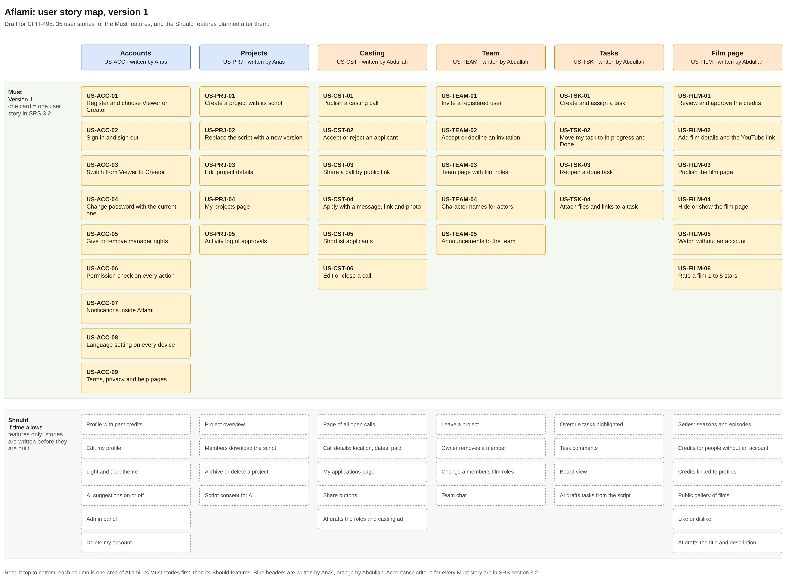
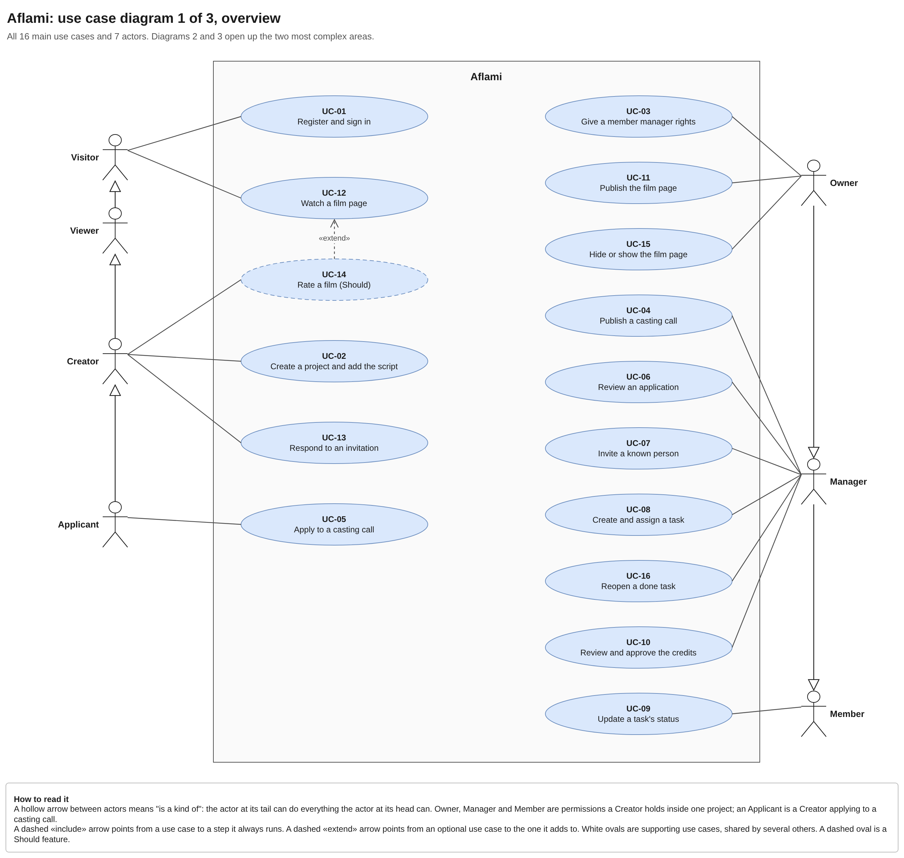
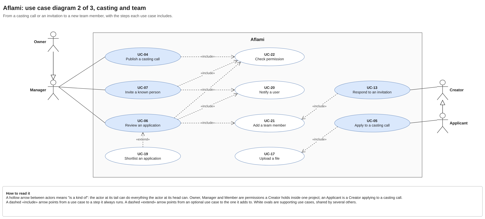
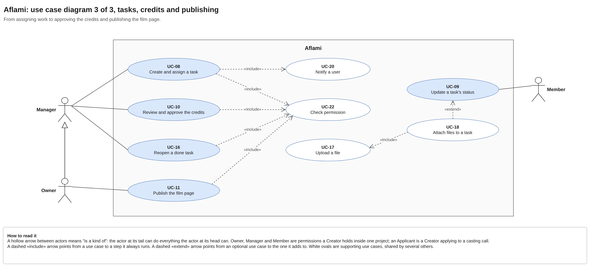

# Aflami Software Requirements Specification

## Document control

This is the requirements document for Aflami, structured after the SRS outline in ISO/IEC/IEEE 29148:2018. Sections 1 to 5 below follow that outline; replace each *Guidance* line with your own text and delete it before you submit.

| Field | Value |
| --- | --- |
| Project | Aflami: one platform for a short film's journey, from project to published film page |
| Course | CPIT-498 (requirements and design), Faculty of Computing and IT, King Abdulaziz University |
| Authors | Anas Aazib, Abdullah Al-Jadani |
| Supervisor | Prof. Adeeb Rida Noor |
| Standard | ISO/IEC/IEEE 29148:2018, Software requirements specification |
| Version | 0.1, template |

**Requirement IDs.** Every requirement gets an ID that never changes, so diagrams and tests can point to it:

| Prefix | Area | Writer |
| --- | --- | --- |
| FR-ACC | Accounts, roles and permissions | Anas |
| FR-PRJ | Projects and scripts | Anas |
| FR-CST | Casting calls and applications | Abdullah |
| FR-TEAM | Team, invitations and film roles | Abdullah |
| FR-TSK | Tasks | Abdullah |
| FR-FILM | Film page and credits | Abdullah |
| NFR-xxx | Non-functional (SEC, PRV, USA, PERF, REL, MNT) | Anas |

**Every requirement carries the same attributes**, as 29148 asks: ID, statement ("The system shall …"), rationale, priority (Must / Should / Future), source (user story or supervisor), and verification method (Test, Demonstration, Inspection or Analysis).

## 1 Introduction

### 1.1 Purpose

This SRS defines what version 1 of Aflami must do. It is the agreement between the team, the supervisor and the committee, and the base for the design in CPIT-498 and the build and tests in CPIT-499.

*Guidance: name the readers and how each one uses this document.*

### 1.2 Scope

Aflami is an Arabic-first web platform for student and independent short-film makers in Saudi Arabia and their crews. In one place, a team creates its project, casts its members, distributes the tasks and publishes a film page with full credits. Today these steps are spread across WhatsApp, shared drives and social media; Aflami links them into one record, so every person who worked on the film ends up in its credits. The first planned users are student filmmakers and university film clubs.

Aflami has three kinds of user. A **Visitor** has no account and can only watch published film pages. A **Viewer** has an account, which liking or disliking a film (a Should feature) needs. A **Creator** chooses that type at sign-up, or switches from Viewer later, and can create projects, apply to casting calls, join teams and rate films. Inside each project, a Creator is the Owner, a Manager or a Member (section 1.5).

Every feature has one of three levels:

- **Must:** part of version 1; the CPIT-499 build is not finished without it.
- **Should:** part of version 1 if time allows; built only after every Must feature works.
- **Future:** not in version 1.

| Area | Must | Should | Future |
| --- | --- | --- | --- |
| Accounts | Registration and sign-in; sign out; account type (Viewer or Creator) chosen at sign-up; permission levels Owner, Manager and Member, with the owner choosing managers; notifications inside the site; my projects page; change password using the old password | Profile with past credits and a link to past work; edit my profile; delete my account | Email notifications; reset a forgotten password (needs an email service); sign in with Google or Apple |
| Projects and scripts | Create a project and upload the script (PDF, Word, Pages or plain text; only the newest is kept); edit project details | Project overview; members download the script; archive or delete a project | Script version history; project poster; transfer ownership |
| Casting | Publish casting calls, apply, shortlist, accept or reject; a public link for each call; edit and close a call; applicant adds a photo or a demo-reel link | A page of all open calls; call details (location, shooting dates, paid or unpaid); my applications page; share buttons | Withdraw an application; filter and sort applications; automatic posting to social media; audition scheduling |
| Team | Invitations to registered users, accepted or declined on an invitation page; team page with each member's film roles; character names for actors | Leave a project; owner removes a member; change a member's film roles | Team contact list |
| Tasks | Create, assign and update tasks (To do, In progress, Done); the owner or a manager reopens a done task; task attachments (images, files and links, with a size limit) | Overdue tasks highlighted; task comments; board view | Production scheduling; calendar view; my tasks across projects |
| Film page and credits | Credits proposed from the team, then edited and approved; film page with the YouTube video, synopsis, details and credits; only the owner publishes; public or hidden at any time; watching without an account; star rating 1 to 5 by Creators outside the film's team | Series: a project can be a series, with a series page listing its seasons and episodes and a page for each episode; credits for people without an account; credits linked to profiles; public gallery of films; like or dislike | "Next episode" pop-up (needs our own video player); our own video hosting or direct upload to YouTube; viewer search and recommendations; reorder credits; viewer comments |
| Communication | Announcements from the owner; activity log of who approved what, and when | Team chat | — |
| Interface and platform | Arabic, right to left, on phone and desktop; Arabic and English switch for the interface (team content is never translated); terms of use and privacy policy; help and FAQ | Light and dark theme; admin panel | Landing page; report inappropriate content |
| AI assistance | — | AI drafts of the roles and casting ad, the tasks, and the film title and description, from the script; a person approves, edits or rejects every draft; every suggestion and its outcome is logged; script consent and privacy before any script is sent | — |

**Success criterion.** Version 1 succeeds when two real filmmaker teams complete the whole journey on Aflami: create the project, build the team, finish the tasks and publish the film page. For each team we report the time per step, whether they completed it without help, and the errors they met.

### 1.3 Product perspective

Aflami is a new, self-contained web system. Today the same teams use WhatsApp, shared drives and social media for these steps; Aflami keeps the project, the people and their roles in one linked record.

| Interface (29148) | What Aflami needs (draft) |
| --- | --- |
| 1.3.1 System interfaces | YouTube embedded player on the film page |
| 1.3.2 User interfaces | Arabic-first, right-to-left, responsive web screens (list them; wireframes in the design document) |
| 1.3.3 Hardware interfaces | None: any device with a current web browser |
| 1.3.4 Software interfaces | PostgreSQL database; YouTube embed; GitHub Actions and Vercel for build and deployment |
| 1.3.5 Communications interfaces | HTTPS only. No email in version 1: invitations and results appear as notifications inside Aflami. |
| 1.3.6 Memory constraints | None specific. *Guidance: write "None" if that stays true.* |
| 1.3.7 Operations | Who deploys, how often the database is backed up, how a release is rolled back |
| 1.3.8 Site adaptation | Arabic locale and the Asia/Riyadh time zone for dates and deadlines |

### 1.4 Product functions

1. **Create a project:** the owner adds the idea and the script.
2. **Build the team:** the owner publishes casting calls, reviews applications and invites known people.
3. **Distribute the work:** tasks get an owner, a deadline and a status.
4. **Publish the film page:** the YouTube video and the credits, reviewed by the owner before publishing.

### 1.5 User characteristics

Every person has one account type. Inside each project, a Creator also has one permission level.

| User class | Who | What they can do | Expected skill |
| --- | --- | --- | --- |
| Visitor | Anyone without an account | Watch published film pages | None |
| Viewer | Account of type Viewer | Everything a Visitor can, plus like or dislike a film (Should) | Basic web use |
| Creator | Account of type Creator, chosen at sign-up or switched to later from Viewer | Create projects, apply to casting calls, join teams, and rate films 1 to 5 (not their own team's film) | Basic web use |
| Owner | Creator who creates the project | Everything, including publishing or hiding the film page and giving or removing manager rights | Basic web use |
| Manager | Member chosen by the owner; a project can have several | Everything except publishing and managing permissions: accept applicants, invite people, manage tasks, approve credits | Basic web use |
| Member | Accepted team member | See the project, update the tasks they own; a member with the Screenwriter film role can also upload a new script | Basic web use |
| Applicant | Creator who applies to a casting call | See only their own application until accepted | Basic web use |

*Decided in week 11: the second level is called Manager, so it never clashes with film roles such as Director or Producer. Decided in week 12: three account types, Visitor, Viewer and Creator; only Creators apply to casting calls and join teams.*

### 1.6 Limitations

- Two developers and one semester (CPIT-499) to build and test.
- Free hosting tiers, with their limits on requests and database size.
- Video playback depends on YouTube; Aflami stores links, not video files.

### 1.7 Assumptions and dependencies

- YouTube embedding stays available for public and unlisted videos.
- Two student teams agree to take part in the evaluation.
- *Guidance: add each assumption whose failure would change a requirement.*

### 1.8 Apportioning of requirements

Each requirement in section 3 takes the level of its feature in section 1.2: Must, Should or Future. CPIT-499 builds every Must requirement first, one area per iteration, then the Should requirements in the order the team agrees. Future requirements are listed for completeness and are not built or tested in version 1.

## 2 References

1. ISO/IEC/IEEE 29148:2018, *Systems and software engineering — Life cycle processes — Requirements engineering*.
2. Aflami project proposal, CPIT-498, revised version.
3. Aflami MVP journey document.
4. Aflami first presentation, November 2026.
5. [Aflami Software Design Document](../design/Aflami_SDD.md).

*Guidance: list every document this SRS depends on, with its version and date.*

## 3 Specific requirements

Each requirement below uses the attributes from Document control. The rows marked *starter* come from the design so far; keep, edit or delete them.

### 3.1 External interfaces

- **YouTube link:** the owner pastes a public or unlisted YouTube link; the system checks it is a YouTube video link before saving.
- *Guidance: for each input and output, give its source or destination, valid range and format.*

### 3.2 Functions

Functions are written three ways that point to each other: user stories (what people want), use cases (how the interaction runs) and requirements (what the system shall do, one testable sentence each).

**User stories.** Every Must feature in section 1.2 is covered by one or more of the 35 stories below. Each is written as "As a …, I want …, so that …", with acceptance criteria in the form "Given …, when …, then …". Should features get their stories before they are built. The story map shows all of them by area.

Source: `design/diagrams/Aflami_User_Story_Map.drawio`.

#### Accounts (US-ACC, written by Anas)

**US-ACC-01 Register and choose Viewer or Creator.** As a new user, I want to create an account and choose Viewer or Creator, so that I can use Aflami the way I need.

- Given the sign-up form, when I enter a name, an email, a password and an account type and accept the terms, then my account is created and I am signed in.
- Given an email that already has an account, when I try to register with it, then the system refuses and says the email is taken.
- Given I have not accepted the terms of use and privacy policy, when I submit, then no account is created.
- *Related: UC-01, FR-ACC-01, NFR-PRV-03.*

**US-ACC-02 Sign in and sign out.** As a registered user, I want to sign in and sign out, so that only I can use my account.

- Given a correct email and password, when I sign in, then I am signed in and see my first screen.
- Given a wrong password, when I sign in, then the system refuses without saying whether the email has an account.
- Given I am signed in, when I sign out, then pages that need an account do not open until I sign in again.
- *Related: UC-01.*

**US-ACC-03 Switch from Viewer to Creator.** As a Viewer, I want to become a Creator, so that I can start projects and apply to casting calls.

- Given a Viewer account, when I choose to become a Creator in my settings, then my account type changes to Creator.
- Given a Viewer, when I try to apply to a casting call or create a project, then the system asks me to switch to Creator first.

**US-ACC-04 Change password with the current one.** As a user, I want to change my password by entering my current one, so that I can keep my account safe without an email service.

- Given the correct current password and a new password typed twice, when I save, then the new password works from my next sign-in.
- Given a wrong current password, when I save, then nothing changes.
- *Related: NFR-SEC-03.*

**US-ACC-05 Give or remove manager rights.** As an owner, I want to make a member a manager, or remove that right, so that trusted people can run the project with me.

- Given an active member, when the owner makes them a manager, then they can accept applicants, invite people, manage tasks and approve credits.
- Given a project with one manager, when the owner makes a second member a manager, then both keep manager rights.
- Given a manager, when they try to give manager rights or publish the film page, then the system refuses.
- *Related: UC-03, FR-ACC-03.*

**US-ACC-06 Permission check on every action.** As a project member, I want every action checked against my permission, so that no one outside the project sees or changes our work.

- Given a user with no active membership, when they open a project's script, tasks or applications, then the system refuses.
- Given a member who has left, when they open the project, then its private content no longer opens.
- *Related: FR-ACC-02, NFR-PRV-01.*

**US-ACC-07 Notifications inside Aflami.** As a user, I want notifications inside Aflami for invitations, application results, new tasks and announcements, so that I don't miss what needs me.

- Given I am invited to a project, when I open Aflami, then I see a new notification that links to the invitation.
- Given an unread notification, when I open it, then it is marked as read.
- *Related: FR-TEAM-02.*

**US-ACC-08 Language setting on every device.** As a user, I want to choose Arabic or English once, so that Aflami shows my language on any device.

- Given I switch the language to English, when I sign in on another device, then Aflami shows in English.
- Given I switch the language, when I open a project, then menus and buttons change but what the team wrote stays as written.
- Given a visitor without an account, when they switch the language, then the choice is kept in their browser.
- *Related: NFR-USA-03, NFR-USA-04.*

**US-ACC-09 Terms, privacy and help pages.** As a visitor, I want to read the terms of use, the privacy policy and a help page, so that I know how Aflami works and uses my data.

- Given any page, when I open the links at the bottom, then the terms, privacy policy and help pages open without an account.
- Given the sign-up form, when I read it, then links to the terms and the privacy policy are shown before I accept them.
- *Related: NFR-PRV-03.*

#### Projects (US-PRJ, written by Anas)

**US-PRJ-01 Create a project with its script.** As a Creator, I want to create a project with a title, an idea and the script, so that my team works from one place.

- Given a Creator, when they create a project with a title and an idea, then they become its owner and the project starts as a draft film.
- Given a script in PDF, Word (.docx), Pages or plain text up to 10 MB, when the owner uploads it, then only the project's members can open it.
- Given a file of another type or over 10 MB, when it is uploaded, then the system refuses and says why.
- *Related: UC-02, FR-PRJ-01, FR-PRJ-02, NFR-SEC-04.*

**US-PRJ-02 Replace the script with a new version.** As an owner, a manager or the project's screenwriter, I want a new script upload to replace the old one, so that the team always reads the newest version.

- Given a project with a script, when the owner, a manager or a member with the Screenwriter film role uploads a new one, then the old file is deleted and members see only the new one.
- Given a member without manager rights or the Screenwriter film role, when they try to upload a script, then the system refuses.
- *Related: FR-PRJ-02, FR-PRJ-04.*

**US-PRJ-03 Edit project details.** As an owner or manager, I want to edit the project's title and idea, so that the project stays accurate.

- Given an owner or a manager, when they save new details, then members see the change.
- Given a member without manager rights, when they try to edit the details, then the system refuses.

**US-PRJ-04 My projects page.** As a Creator, I want to see the projects I own or belong to, so that I can open any of them quickly.

- Given I own one project and belong to another, when I open My projects, then both appear with my permission in each.
- Given a project I have left, when I open My projects, then it no longer appears.

**US-PRJ-05 Activity log of approvals.** As an owner or manager, I want a log of who approved what and when, so that the project's decisions stay clear later.

- Given a manager accepts an applicant or approves the credits, when the owner or a manager opens the activity log, then it shows who did it and when.
- Given a member without manager rights, when they try to open the activity log, then the system refuses.
- Given an entry in the log, when anyone tries to edit or delete it, then the system refuses.

#### Casting (US-CST, written by Abdullah)

**US-CST-01 Publish a casting call.** As an owner or manager, I want to publish a casting call for a film role with a description and a deadline, so that people can apply.

- Given an owner or a manager, when they publish a call with a film role, a description and a deadline, then the call is open and has a public link.
- Given a member without manager rights, when they try to publish a call, then the system refuses.
- *Related: UC-04, FR-CST-01.*

**US-CST-02 Accept or reject an applicant.** As an owner, I want to accept or reject each applicant, so that only the people I choose join my project.

- Given an application in Submitted, when the owner accepts it, then it becomes Accepted and the applicant becomes a member with the call's film role.
- Given an applicant who is already a member, when accepted for a second call, then no second membership is made and the new film role is added.
- Given a member without manager rights, when they try to accept, then the system refuses.
- *Related: UC-06, FR-CST-02.*

**US-CST-03 Share a call by public link.** As an owner, I want each casting call to have a public link, so that I can share it on Instagram and LinkedIn.

- Given an open call, when anyone opens its link, then they see the role, the description and the deadline without signing in, and no email addresses.
- Given someone without a Creator account, when they choose Apply, then they are asked to sign in or register as a Creator first.
- *Related: NFR-PRV-02.*

**US-CST-04 Apply with a message, link and photo.** As a Creator, I want to apply with a message, and optionally a link to my work and a photo, so that the team can judge me.

- Given an open call, when a Creator sends a message, with or without a link and a photo, then the application is Submitted.
- Given a Creator who already applied to this call, when they apply again, then the system refuses.
- Given a closed call, when someone tries to apply, then the system refuses.
- *Related: UC-05.*

**US-CST-05 Shortlist applicants.** As an owner or manager, I want to shortlist applicants before deciding, so that I can compare the strongest ones.

- Given a Submitted application, when it is shortlisted, then it shows in the shortlist and stays Submitted.
- Given a shortlisted application, when the applicant views it, then they do not see the shortlist mark.

**US-CST-06 Edit or close a call.** As an owner or manager, I want to edit an open call or close it, so that it stays accurate and stops when the role is filled.

- Given an open call, when it is edited, then its public link shows the new details.
- Given an open call, when it is closed, then no new applications are accepted and the Submitted ones stay for the team to decide.
- Given a closed call, when an applicant with a Submitted application views it, then they see that the call is closed and under review.

#### Team (US-TEAM, written by Abdullah)

**US-TEAM-01 Invite a registered user.** As an owner or manager, I want to invite a person who is already on Aflami for a film role, so that I can add people I know without a casting call.

- Given a registered Creator, when they are invited for a film role, then they get a notification inside Aflami and the invitation is Pending.
- Given an email with no Aflami account, when someone tries to invite it, then the system says the person must register first and sends nothing.
- *Related: UC-07, FR-TEAM-02.*

**US-TEAM-02 Accept or decline an invitation.** As an invited Creator, I want to accept or decline an invitation, so that I only join teams I choose.

- Given a Pending invitation, when I accept it, then I become an active member with its film role.
- Given a Pending invitation, when I decline it, then I do not join and the inviter sees Declined.
- *Related: UC-13, FR-TEAM-02.*

**US-TEAM-03 Team page with film roles.** As a member, I want a team page that shows each member's film roles, so that everyone knows who does what.

- Given a team, when a member opens the team page, then each active member shows with their permission and all their film roles.
- Given a member who holds two film roles, when the team page opens, then both roles appear.
- *Related: FR-TEAM-01.*

**US-TEAM-04 Character names for actors.** As an owner or manager, I want to set each actor's character name, so that the credits read "Reem as Noura".

- Given an actor in the team, when their character name is saved, then the team page and the proposed credits show it.

**US-TEAM-05 Announcements to the team.** As an owner or manager, I want to post an announcement with a title and a text, so that the whole team gets the same message.

- Given an owner or a manager, when they post an announcement, then every active member sees it on the project page and gets a notification.
- Given a member without manager rights, when they try to post an announcement, then the system refuses.

#### Tasks (US-TSK, written by Abdullah)

**US-TSK-01 Create and assign a task.** As an owner or manager, I want to create a task with a deadline and assign it to a member, so that everyone knows their work.

- Given an owner or a manager, when they create a task and choose an active member, then the task is To do and the member is notified.
- Given a person who is not an active member, when choosing who owns a task, then they cannot be chosen.
- *Related: UC-08.*

**US-TSK-02 Move my task to In progress and Done.** As a task owner, I want to move my task from To do to In progress to Done, so that the team sees progress.

- Given my task in To do, when I start it, then it becomes In progress; when I finish it, then it becomes Done.
- Given a task I do not own, when I try to change its status, then the system refuses.
- *Related: UC-09, FR-TSK-01.*

**US-TSK-03 Reopen a done task.** As an owner or manager, I want to reopen a Done task, so that work that needs changes goes back to its owner.

- Given a Done task, when the owner or a manager reopens it, then it returns to In progress.
- Given the task's owner without manager rights, when they try to reopen it, then the system refuses.
- *Related: FR-TSK-02.*

**US-TSK-04 Attach files and links to a task.** As a member, I want to attach images, files and links to a task, so that the work and its results stay together.

- Given a task, when a member attaches an image or a file up to 10 MB, or a link, then the team can open it.
- Given a file over 10 MB or of a type that is not allowed, when it is attached, then the system refuses and says why.
- *Related: NFR-SEC-04.*

#### Film page (US-FILM, written by Abdullah)

**US-FILM-01 Review and approve the credits.** As an owner or manager, I want the credits proposed from the team's film roles, so that I only review and approve them.

- Given a team with film roles, when the credits are proposed, then each member's name, film role and character name appears as Proposed.
- Given a proposed credit, when the owner or a manager edits and approves it, then it becomes Approved and records who approved it.
- Given a member without manager rights, when they try to approve, then the system refuses.
- *Related: UC-10, FR-FILM-01.*

**US-FILM-02 Add film details and the YouTube link.** As an owner or manager, I want to add the synopsis, the YouTube link, the genre, the duration, the year and the language, so that the film page is complete.

- Given a YouTube link, when it is saved, then the system checks that it is a YouTube video link.
- Given saved details, when the film page opens, then they appear on it.

**US-FILM-03 Publish the film page.** As an owner, I want to publish the film page when the video and the credits are ready, so that people can watch the film and see who made it.

- Given a YouTube link and approved credits, when the owner publishes, then the page becomes public.
- Given a missing YouTube link or unapproved credits, when the owner tries to publish, then the system says what is missing.
- Given a manager, when they try to publish, then the system refuses.
- *Related: UC-11, FR-FILM-03.*

**US-FILM-04 Hide or show the film page.** As an owner, I want to hide a published film page and show it again, so that I control when people can see it.

- Given a published page, when the owner hides it, then visitors can no longer open it and the team still can.
- Given a hidden page, when the owner shows it again, then it is public again with its ratings kept.
- *Related: UC-15.*

**US-FILM-05 Watch without an account.** As a visitor, I want to watch a published film and see its credits without signing up, so that anyone can enjoy and share it.

- Given a published film page, when a visitor opens its link, then the video plays and the credits show.
- Given a draft or hidden page, when a visitor opens its link, then they see that it is not available.
- *Related: UC-12, FR-FILM-02.*

**US-FILM-06 Rate a film 1 to 5 stars.** As a Creator, I want to rate a film from 1 to 5 stars, so that good work gets recognised.

- Given a published film, when a Creator outside its team rates it, then the page shows the new average and count.
- Given a Creator who rated it before, when they rate again, then their rating changes and the count stays the same.
- Given a Viewer, or a member of the film's team, when they try to rate, then the system refuses.
- *Related: UC-14.*

**Use cases.** Sixteen main use cases, plus six supporting use cases that the main ones include or that extend them. UC-14 Rate a film also extends UC-12 Watch a film page.

| ID | Use case | Primary actor | Writer |
| --- | --- | --- | --- |
| UC-01 | Register (choose Viewer or Creator) and sign in | Any user | Anas |
| UC-02 | Create a project and add the script | Owner | Anas |
| UC-03 | Give a member manager rights | Owner | Anas |
| UC-04 | Publish a casting call | Owner, Manager | Abdullah |
| UC-05 | Apply to a casting call | Applicant | Abdullah |
| UC-06 | Review an application | Owner, Manager | Abdullah |
| UC-07 | Invite a known person | Owner, Manager | Abdullah |
| UC-08 | Create and assign a task | Owner, Manager | Abdullah |
| UC-09 | Update a task's status | Task owner | Abdullah |
| UC-10 | Review and approve the credits | Owner, Manager | Abdullah |
| UC-11 | Publish the film page | Owner | Abdullah |
| UC-12 | Watch a film page | Visitor or Viewer | Abdullah |
| UC-13 | Respond to an invitation | Invited Creator | Abdullah |
| UC-14 | Rate a film | Creator | Abdullah |
| UC-15 | Hide or show the film page | Owner | Abdullah |
| UC-16 | Reopen a done task | Owner, Manager | Abdullah |

**Supporting use cases:**

| ID | Use case | Relation | Used by | What it does | Writer |
| --- | --- | --- | --- | --- | --- |
| UC-17 | Upload a file | «include» | UC-02, UC-05, UC-18 | Checks the file's type and size (up to 10 MB) and stores it privately | Anas |
| UC-18 | Attach files to a task | «extend» | UC-09 | Adds images, files or links to a task; includes UC-17 | Abdullah |
| UC-19 | Shortlist an application | «extend» | UC-06 | Marks a Submitted application as shortlisted; the applicant does not see the mark | Abdullah |
| UC-20 | Notify a user | «include» | UC-06, UC-07, UC-08 | Creates a notification inside Aflami for the person concerned | Anas |
| UC-21 | Add a team member | «include» | UC-06, UC-13 | Creates the membership with the film role, or adds the role if the person is already a member | Abdullah |
| UC-22 | Check permission | «include» | UC-03, UC-04, UC-06, UC-07, UC-08, UC-10, UC-11, UC-15, UC-16 | Reads the user's membership in the project and refuses the action if the permission is too low | Anas |

**Use case diagrams.** Three diagrams: an overview of the whole system, then the two most complex areas opened up with their «include» and «extend» relations. Owner, Manager and Member are permissions a Creator holds inside one project; a hollow arrow between actors means "is a kind of".

**Why this structure.** «include» is used only for a step that always runs inside several use cases (UC-17 Upload a file, UC-20 Notify a user, UC-21 Add a team member, UC-22 Check permission), so each is described once and reused. «extend» is used only for an optional step the user chooses (UC-14 Rate a film, UC-18 Attach files to a task, UC-19 Shortlist an application). Reopen a done task (UC-16) is a main use case, not an extension of UC-09, because its actor differs: only the owner or a manager may reopen a task, while UC-09 belongs to the task's owner. Actors inherit from one another, so each use case is linked to the least powerful actor allowed to run it.

1. Overview: 
2. Casting and team: 
3. Tasks, credits and publishing: 

Sources: `design/diagrams/Aflami_Use_Case_Diagram.drawio`, `design/diagrams/Aflami_Use_Case_Casting_Team.drawio`, `design/diagrams/Aflami_Use_Case_Tasks_Credits.drawio`.

**Use case descriptions.** Each gives the primary actor, the preconditions, the main flow, the alternative flows and exceptions, the postcondition and the related stories and requirements. The supporting use cases are described in their table above.

#### Accounts and projects (UC-01 to UC-03, written by Anas)

> **UC-01 Register and sign in.** Primary actor: Visitor. Preconditions: Not signed in.
>
> Main flow:
>
> 1. The visitor chooses Sign up.
> 2. The system shows the form: name, email, password and account type (Viewer or Creator), with links to the terms of use and the privacy policy.
> 3. The visitor fills it in, accepts the terms and submits.
> 4. The system checks that the email is not taken, creates the account with default settings, and signs the person in.
> 5. The system shows the first screen: My projects for a Creator, the film pages for a Viewer.
>
> - Alternative flow 1a: the person already has an account and chooses Sign in; they enter the email and password, and the system signs them in.
> - Exception 3a: the terms are not accepted; no account is created.
> - Exception 4a: the email already has an account; the system says so and creates nothing.
> - Exception 1a.1: the password is wrong; the system refuses without saying whether the email has an account.
>
> Postcondition: the person has one account with one settings row and is signed in. Related: FR-ACC-01, US-ACC-01, US-ACC-02, NFR-PRV-03, NFR-SEC-01.

> **UC-02 Create a project and add the script.** Primary actor: Creator. Preconditions: Signed in as a Creator.
>
> Main flow:
>
> 1. The Creator chooses New project.
> 2. The Creator enters a title and an idea.
> 3. The system creates the project as a draft film, makes the Creator its owner, and creates the film's single episode.
> 4. The owner uploads the script.
> 5. The system checks the file type (PDF, DOCX, Pages or TXT) and size (up to 10 MB), stores it privately, and links it to the episode (UC-17 Upload a file).
> 6. The system shows the project page.
>
> - Alternative flow 4a: the owner adds the script later from the project page.
> - Exception 1a: the account is a Viewer; the system asks the person to switch to Creator first.
> - Exception 5a: the file type or size is not allowed; the system refuses and says why.
>
> Postcondition: a draft project exists with its owner and, if uploaded, its script. Related: FR-PRJ-01, FR-PRJ-02, US-PRJ-01, NFR-SEC-04.

> **UC-03 Give a member manager rights.** Primary actor: Owner. Preconditions: Signed in; the project has an active member.
>
> Main flow:
>
> 1. The owner opens the team page.
> 2. The owner chooses a member and Make manager.
> 3. The system checks that the actor is the project's owner (UC-22 Check permission).
> 4. The system changes the member's permission to Manager and records it in the activity log.
> 5. The team page shows the member as a manager.
>
> - Alternative flow 2a: the owner chooses Remove manager rights on a manager; the system makes them a member again.
> - Exception 3a: the actor is not the owner; the system refuses and changes nothing.
>
> Postcondition: the member is a manager; the project still has one owner. Related: FR-ACC-03, US-ACC-05, US-PRJ-05.

#### Casting, team, tasks and film page (UC-04 to UC-16, written by Abdullah)

> **UC-04 Publish a casting call.** Primary actor: Owner or Manager. Preconditions: Signed in as the project's owner or a manager.
>
> Main flow:
>
> 1. The actor opens Casting and chooses New call.
> 2. The actor enters the film role, a description and a deadline.
> 3. The system checks the actor's permission (UC-22) and that the deadline is in the future.
> 4. The system saves the call as Open and creates its public link.
> 5. The actor copies the link to share it.
>
> - Alternative flow 1a: the actor edits an open call; the same link shows the new details.
> - Alternative flow 1b: the actor closes an open call; it stops taking applications and the Submitted ones stay for review.
> - Exception 3a: the actor is a member without manager rights; the system refuses.
>
> Postcondition: an open call with a public link. Related: FR-CST-01, US-CST-01, US-CST-03, US-CST-06.

> **UC-05 Apply to a casting call.** Primary actor: Applicant (a Creator). Preconditions: The call is open.
>
> Main flow:
>
> 1. The applicant opens the call's link.
> 2. The system shows the film role, the description and the deadline.
> 3. The applicant chooses Apply and writes a message, optionally adding a link to past work and a photo.
> 4. The system checks that the call is still open and that this person has not applied to it before.
> 5. The system saves the application as Submitted and confirms it; a photo goes through UC-17 Upload a file.
>
> - Alternative flow 3a: the person is not signed in as a Creator; the system asks them to sign in or register as a Creator, then returns to the call.
> - Exception 4a: the person already applied, or the call is closed; the system refuses.
> - Exception 4b: the photo's type or size is not allowed; the system refuses and says why.
>
> Postcondition: one Submitted application for this person and call. Related: US-CST-03, US-CST-04, NFR-PRV-02.

> **UC-06 Review an application.** Primary actor: Owner or Manager. Preconditions: Signed in; the application is Submitted.
>
> Main flow:
>
> 1. The actor opens a casting call.
> 2. The system lists its applications.
> 3. The actor opens one and chooses Accept.
> 4. The system marks it Accepted, records who decided and when, and adds the applicant to the team with the call's film role (UC-21 Add a team member).
> 5. The system notifies the applicant (UC-20 Notify a user) and shows the new member in the team.
>
> - Alternative flow 3a: the actor chooses Reject; the system marks it Rejected and notifies the applicant.
> - Alternative flow 3b: the actor shortlists it (UC-19, which extends this use case); it stays Submitted and the applicant does not see the mark.
> - Alternative flow 4a: the applicant is already a member; the system adds the new film role instead of a second membership.
> - Exception: the actor is not the owner or a manager (UC-22); the system refuses and changes nothing.
>
> Postcondition: the applicant is a member of this project only. Related: FR-CST-02, FR-ACC-02, US-CST-02, US-CST-05.

> **UC-07 Invite a known person.** Primary actor: Owner or Manager. Preconditions: Signed in as the project's owner or a manager.
>
> Main flow:
>
> 1. The actor opens the team page and chooses Invite.
> 2. The actor enters the person's email and a film role.
> 3. The system checks the actor's permission (UC-22) and finds the person's Aflami account.
> 4. The system creates a Pending invitation and notifies the person inside Aflami (UC-20).
>
> - Exception 3a: no Aflami account has that email; the system says the person must register first and sends nothing.
> - Exception 3b: the person is already an active member; the system says so.
>
> Postcondition: a Pending invitation. Related: FR-TEAM-02, US-TEAM-01, US-ACC-07.

> **UC-08 Create and assign a task.** Primary actor: Owner or Manager. Preconditions: Signed in; the project has active members.
>
> Main flow:
>
> 1. The actor opens Tasks and chooses New task.
> 2. The actor enters a title, a description and a deadline.
> 3. The actor chooses an active member as the task's owner.
> 4. The system checks the actor's permission (UC-22), saves the task as To do, and notifies the member (UC-20).
> 5. The task appears in the list.
>
> - Alternative flow 3a: the actor leaves the task without an owner and assigns it later.
> - Exception 4a: the actor is a member without manager rights; the system refuses.
>
> Postcondition: a To do task, with or without an owner. Related: US-TSK-01, FR-ACC-02.

> **UC-09 Update a task's status.** Primary actor: Task owner (a Member). Preconditions: Signed in; the task is assigned to this member.
>
> Main flow:
>
> 1. The member opens the task.
> 2. The member chooses Start; the system checks they own the task and moves it to In progress.
> 3. The member chooses Finish; the system moves it to Done.
>
> - Alternative flow 2a: the member attaches images, files or links (UC-18, which extends this use case).
> - Alternative flow 3a: after Done, the owner or a manager can reopen the task (UC-16).
> - Exception: the actor does not own the task; the system refuses.
>
> Postcondition: the task shows its new status to the team. Related: FR-TSK-01, FR-TSK-02, US-TSK-02, US-TSK-03, US-TSK-04.

> **UC-10 Review and approve the credits.** Primary actor: Owner or Manager. Preconditions: Signed in; team members have film roles.
>
> Main flow:
>
> 1. The actor opens Credits.
> 2. The system proposes one credit for each member's film role, with character names, as Proposed.
> 3. The actor edits any credit that needs it.
> 4. The actor approves the credits; the system checks the actor's permission (UC-22).
> 5. The system marks them Approved, records who approved them, and adds the approval to the activity log.
>
> - Alternative flow 3a: the actor removes a proposed credit.
> - Exception: the actor is a member without manager rights; the system refuses.
>
> Postcondition: every credit to publish is Approved. Related: FR-FILM-01, US-FILM-01, US-TEAM-04, US-PRJ-05.

> **UC-11 Publish the film page.** Primary actor: Owner. Preconditions: Signed in; the project is a draft.
>
> Main flow:
>
> 1. The owner opens the film page settings.
> 2. The owner adds or checks the synopsis, the details and the YouTube link.
> 3. The owner chooses Publish.
> 4. The system checks that the actor is the owner (UC-22), that the YouTube link is valid and that the credits are approved.
> 5. The system marks the project Published and the page becomes public.
>
> - Exception 4a: the YouTube link is missing or the credits are not approved; the system says what is missing.
> - Exception 4b: a manager tries to publish; the system refuses.
>
> Postcondition: a public film page. Related: FR-FILM-03, US-FILM-02, US-FILM-03.

> **UC-12 Watch a film page.** Primary actor: Visitor or Viewer. Preconditions: The page is published.
>
> Main flow:
>
> 1. The person opens the film page's link.
> 2. The system shows the video in the YouTube player, the synopsis, the details, the approved credits and the average rating.
> 3. The person plays the video.
>
> - Exception 1a: the page is a draft or hidden; the system says it is not available.
>
> Postcondition: nothing changes. Related: FR-FILM-02, US-FILM-05, NFR-PRV-02.

> **UC-13 Respond to an invitation.** Primary actor: Invited Creator. Preconditions: Signed in; the invitation is Pending.
>
> Main flow:
>
> 1. The Creator opens the invitation's notification.
> 2. The system shows the project, the film role and who invited them.
> 3. The Creator chooses Accept.
> 4. The system marks it Accepted and adds the Creator to the team with the film role (UC-21 Add a team member).
>
> - Alternative flow 3a: the Creator chooses Decline; the system marks it Declined and the inviter sees it.
>
> Postcondition: the Creator is an active member, or the invitation is Declined. Related: FR-TEAM-02, US-TEAM-02.

> **UC-14 Rate a film.** Primary actor: Creator. Preconditions: Signed in as a Creator; the page is published.
>
> Main flow:
>
> 1. The Creator opens the film page.
> 2. The Creator chooses 1 to 5 stars.
> 3. The system checks that the Creator is not in the film's team.
> 4. The system saves the rating, replacing their earlier one if any.
> 5. The page shows the new average and count.
>
> - Exception 3a: the person is a Viewer; the system asks them to switch to Creator.
> - Exception 3b: the Creator is in the film's team; the system refuses.
>
> Postcondition: one rating per Creator for this film. Related: US-FILM-06.

> **UC-15 Hide or show the film page.** Primary actor: Owner. Preconditions: Signed in; the page is published.
>
> Main flow:
>
> 1. The owner opens the film page settings.
> 2. The owner chooses Hide.
> 3. The system checks that the actor is the owner and marks the page Hidden.
> 4. Visitors can no longer open it; the team still can.
>
> - Alternative flow 2a: the page is hidden and the owner chooses Show; the page is public again with its ratings kept.
> - Exception 3a: a manager tries to hide or show the page; the system refuses.
>
> Postcondition: the page is Hidden, or Published again. Related: US-FILM-04.

> **UC-16 Reopen a done task.** Primary actor: Owner or Manager. Preconditions: Signed in as the project's owner or a manager; the task is Done.
>
> Main flow:
>
> 1. The actor opens a Done task.
> 2. The actor chooses Reopen.
> 3. The system checks the actor's permission (UC-22).
> 4. The system moves the task back to In progress and keeps its owner.
>
> - Exception 3a: the actor is a member without manager rights, even the task's own owner; the system refuses.
>
> Postcondition: the task is In progress again. Related: FR-TSK-02, US-TSK-03.

**Functional requirements (starter):**

| ID | Requirement | Priority | Source | Verification |
| --- | --- | --- | --- | --- |
| FR-ACC-01 | The system shall let a person register with a name, email and password. | Must | UC-01 | Test |
| FR-ACC-02 | The system shall check the user's role in the project on every request that reads or changes project data. | Must | Supervisor, permissions design | Test |
| FR-ACC-03 | Only the owner shall give or remove manager rights; a project can have several managers. | Must | Week 11 decision, UC-03 | Test |
| FR-PRJ-01 | The system shall let a signed-in user create a project with a title, idea and script. | Must | UC-02 | Test |
| FR-PRJ-02 | The system shall take the script as a PDF, Word (.docx), Pages or plain-text file, show it only to project members, and keep only the newest version (one script per episode; a film has one). | Must | Week 11 decision | Test |
| FR-PRJ-03 | The system shall let the owner make a project a film or a series; a series holds episodes numbered within each season. | Should | Week 12 decision | Test |
| FR-PRJ-04 | Only the owner, a manager or a member with the Screenwriter film role shall upload a new script. | Must | Week 12 decision, US-PRJ-02 | Test |
| FR-CST-01 | The system shall let the owner or a manager publish a casting call with a film role, description and deadline. | Must | UC-04 | Test |
| FR-CST-02 | The system shall create a membership for the applicant when the owner or a manager accepts an application. | Must | US-CST-02, UC-06 | Test |
| FR-TEAM-01 | The system shall let one member hold more than one film role in a project. | Must | Table review scenario | Test |
| FR-TEAM-02 | The system shall let the owner or a manager invite a registered Aflami user; the invitation appears as a notification inside Aflami, and the user joins only after accepting. | Must | Week 11 decision, UC-07 | Test |
| FR-TSK-01 | The system shall move a task only through To do, In progress and Done. | Must | UC-09 | Test |
| FR-TSK-02 | Only the owner or a manager shall reopen a Done task; it returns to In progress. | Must | Week 12 decision | Test |
| FR-FILM-01 | The system shall propose credits from the team's film roles and let the owner or a manager edit and approve them before publishing. | Must | UC-10 | Demonstration |
| FR-FILM-02 | The system shall show a published film page to viewers without an account. | Must | UC-12 | Test |
| FR-FILM-03 | Only the owner shall publish the film page. | Must | Week 11 decision, UC-11 | Test |

### 3.3 Usability requirements
 
| ID | Requirement | Priority | Source | Verification |
| --- | --- | --- | --- | --- |
| NFR-USA-01 | The interface shall be in Arabic, right to left, on phone and desktop screens. | Must | Scope | Inspection |
| NFR-USA-02 | A first-time owner shall create a project and publish a casting call without help. | Should | Evaluation plan | Test with the evaluation teams |
| NFR-USA-03 | Arabic shall be the default language, and a switch shall change the interface to English and back. | Must | Scope | Test |
| NFR-USA-04 | The language switch shall change only the interface (menus, buttons and system messages); what users write shall be shown as written and never translated. | Must | Decision, 16 Nov | Inspection |
| NFR-USA-05 | Arabic, English and mixed text in names, titles, tasks and credits shall be saved and shown in the right direction, with no broken letters. | Must | Arabic-first scope | Test with Arabic sample data |
| NFR-USA-06 | Dates and deadlines shall be shown in the Asia/Riyadh time zone. | Must | Section 1.3.8 | Test |
| NFR-USA-07 | Every screen shall work on a phone screen 360 pixels wide without sideways scrolling. | Must | Scope | Test |
 
### 3.4 Performance requirements
 
| ID | Requirement | Priority | Source | Verification |
| --- | --- | --- | --- | --- |
| NFR-PERF-01 | 95% of page requests shall finish within 3 seconds while 20 users use Aflami at the same time *(proposed)*. | Should | Evaluation with two teams | Test: load test before the evaluation |
| NFR-PERF-02 | The system shall hold at least 50 accounts and 10 projects with their files within the free hosting limits *(proposed)*. | Should | Hosting plan | Analysis |
 
### 3.5 Logical database requirements
 
- The data model has eighteen tables: users, user_settings, projects, episodes, scripts, memberships, member_roles, invitations, casting_calls, applications, tasks, task_attachments, credits, ratings, reactions, notifications, announcements and activity_log. The ERD is in section 2 of the [design document](../design/Aflami_SDD.md).
- A user has at most one membership per project, one application per casting call, and one rating and one reaction per film.
- Film roles come from a fixed list of 25 roles (design document, section 2.1), shown in the language of the interface. Only the Actor role has a character name, and only the Screenwriter role, besides the owner and managers, may upload the script (FR-PRJ-04). The credits on the film page follow the order of that list, then the order in which people joined.
- Every project has at least one episode: a film has exactly one, a series has many.
- Each episode keeps only its newest script: a new upload deletes the old file.
- A member who leaves is marked as left, not deleted, so tasks and credits keep their history.
- Only members of a project can read its script, tasks, attachments and announcements; only the owner and managers can read its applications.
- Retention: applicant photos of people who were not accepted are deleted 30 days after the call closes; files uploaded but never attached to a record are deleted after 1 day; read notifications are deleted after 90 days; the files of a deleted project or account are deleted with it. A scheduled job applies these rules once a day.

### 3.6 Design constraints

- Web front end in Next.js, React and TypeScript; back end in NestJS; database in PostgreSQL.
- Hosting on Vercel; build and tests through GitHub Actions.
- The database and the files are hosted on Supabase (free plan). The back end connects through Supabase's connection pooler in transaction mode, because Vercel cannot use Supabase's direct connection, which is IPv6 only.
- Scheduled jobs (the daily database export and the daily cleanup) run as GitHub Actions workflows. Supabase pauses a free project after one week without activity, so these jobs must also keep the project active. The export is encrypted and pushed to a separate private repository, `aflami-backups`, which keeps the last 30 days.
- Film videos stay on YouTube and are shown through its embedded player.
- Files go straight between the browser and Supabase Storage through signed links, because a Vercel function accepts at most 4.5 MB per request on the free plan.
- Only the AI drafts (a Should feature) call an external AI model: from the back end, never from the browser, and only after the project's owner agrees to send the script.

### 3.7 Standards compliance
 
- ISO/IEC/IEEE 29148:2018 for this document.
- Saudi Personal Data Protection Law: Aflami collects only the personal data it needs, explains why in its privacy policy, and lets users ask for their data to be corrected or deleted (NFR-PRV-03, NFR-PRV-04).

### 3.8 Software system attributes
 
| ID | Attribute | Requirement | Priority | Verification |
| --- | --- | --- | --- | --- |
| NFR-SEC-01 | Security | Passwords shall be stored only as salted hashes. | Must | Inspection |
| NFR-SEC-02 | Security | Every page and every request to the server shall use HTTPS. | Must | Inspection |
| NFR-SEC-03 | Security | Changing a password shall require the current password. | Must | Test |
| NFR-SEC-04 | Security | The system shall accept only allowed file types (scripts: PDF, DOCX, Pages, TXT; photos and attachments: images, PDF, DOCX, TXT), each up to 10 MB *(proposed)*. | Must | Test |
| NFR-SEC-05 | Security | Scripts and task attachments shall open only through links that expire within 15 minutes *(proposed)*, made after a permission check. | Must | Test |
| NFR-SEC-06 | Security | Sign-in to an account shall pause for 15 minutes after 5 failed attempts *(proposed)*. | Should | Test |
| NFR-SEC-07 | Security | Passwords and keys for the database and file storage shall never be stored in the repository. | Must | Inspection |
| NFR-PRV-01 | Privacy | A project's script shall be visible only to its active members. | Must | Test |
| NFR-PRV-02 | Privacy | Public pages (film pages and casting call links) shall show names, film roles and credits only, never email addresses. | Must | Test |
| NFR-PRV-03 | Privacy | A person shall accept the terms of use and privacy policy before the account is created. | Must | Test |
| NFR-PRV-04 | Privacy | A user's personal data shall be deleted when they ask; until "Delete my account" is built, the team deletes it by hand. | Should | Demonstration |
| NFR-PRV-05 | Privacy | An application shall be visible only to the applicant and to the owner and managers of that project. | Must | Test |
| NFR-PRV-06 | Privacy | Personal files and records shall be deleted on the schedule in section 3.5. | Must | Test |
| NFR-REL-01 | Reliability | The database shall be exported automatically once a day; the export shall be encrypted and kept outside the public repository. | Must | Inspection |
| NFR-AVL-01 | Availability | The system shall be available 99% of the time during the evaluation weeks *(proposed)*. | Should | Analysis of uptime logs |
| NFR-MNT-01 | Maintainability | Automated tests shall run on every pull request before merge. | Must | Inspection |
| NFR-MNT-02 | Maintainability | Each feature area (Accounts, Projects, Casting and team, Tasks, Film page) shall be a separate back-end module, with the services they all use in one Shared module, and no two modules shall depend on each other. | Must | Inspection |
| NFR-PRT-01 | Portability | The system shall work on current Chrome, Safari, Firefox and Edge, on desktop and on Android and iOS phones. | Must | Test |

### 3.9 Supporting information

*Guidance: point to the wireframes, the glossary and any sample data that helps a reader understand the requirements.*

## 4 Verification

Every requirement in section 3 is checked in CPIT-499 by one of four methods: **Test** (run with set inputs and an expected result), **Demonstration** (shown working), **Inspection** (code or configuration reviewed) or **Analysis** (worked out from data or a model).

| Requirements | Method | When | Evidence |
| --- | --- | --- | --- |
| FR-ACC-02, NFR-PRV-01, NFR-PRV-05, NFR-SEC-05 | Test: automated permission tests | Every pull request | Test report in GitHub Actions |
| FR-CST, FR-TEAM, FR-TSK | Test: integration tests of each flow | Before the first integrated trial | Test report |
| FR-FILM-01, FR-FILM-02, NFR-PRV-02 | Demonstration and test | First integrated trial | Recording or checklist |
| NFR-SEC-03, NFR-SEC-04, NFR-SEC-06, NFR-PRV-03, NFR-PRV-06 | Test | Before the first integrated trial | Test report |
| NFR-USA-03 to NFR-USA-07, NFR-PRT-01 | Test on phones and browsers with Arabic sample data | Before the evaluation | Checklist with screenshots |
| NFR-USA-01, NFR-USA-02 | Test with the two evaluation teams | Evaluation phase | Time per step, completion without help, errors |
| NFR-PERF-01, NFR-PERF-02, NFR-AVL-01 | Load test and analysis | Before and during the evaluation | Load test results, hosting usage report |
| NFR-SEC-01, NFR-SEC-02, NFR-SEC-07, NFR-MNT-01, NFR-MNT-02, NFR-REL-01, NFR-USA-04 | Inspection | Before the final report | Review checklist |
| NFR-PRV-04 | Demonstration | Before the final report | A deletion done on request |
 
*Guidance: keep one row per requirement group, and make sure no requirement in section 3 is left without a row.*

## 5 Appendices

### 5.1 Acronyms and abbreviations

| Term | Meaning |
| --- | --- |
| SRS | Software requirements specification |
| MVP | Minimum viable product: the scope of version 1 |
| ERD | Entity relationship diagram |
| FR / NFR | Functional / non-functional requirement |
| US / UC | User story / use case |
| CI | Continuous integration: tests that run on every pull request |

### 5.2 Traceability matrix

This matrix ties every requirement to its story, use case, diagrams and test, so each diagram can be checked against the requirements.

| Requirement | User story | Use case | Diagrams | Test |
| --- | --- | --- | --- | --- |
| FR-CST-02 | US-CST-02 | UC-06 | Sequence: accept an applicant; State: application; ERD: applications, memberships | Integration test: accept creates one membership |

*Guidance: add one row per requirement as you write the diagrams in week 13.*
